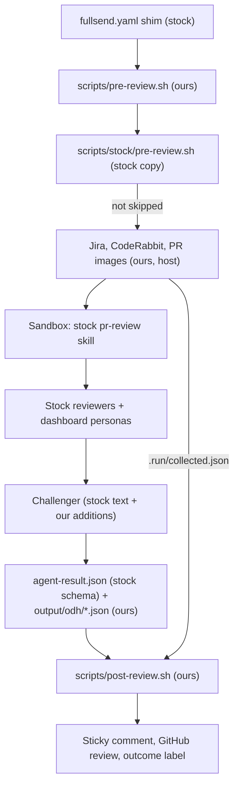

# Fullsend PR review

How Fullsend PR review is set up in this repository. The review runs the stock
`pr-review` skill from [fullsend-ai/agents](https://github.com/fullsend-ai/agents)
v0.57.1 (`ea29de9b`). This directory holds the dashboard layer on top of it:
extra reviewer personas, host adapters, and the host script that renders the
sticky comment and computes the verdict.

**Maintenance:** when you change a persona, a side file, the registry, the
sticky layout or the verdict rules, update this file in the same change.

## How a review runs



1. **Shim (stock).** [`fullsend.yaml`](../.github/workflows/fullsend.yaml) is
   the unmodified v0.57.1 shim. It forwards events to Fullsend's
   `reusable-dispatch.yml`. See [Invocation](#invocation).
2. **Pre-script (ours, wrapping stock).**
   [`scripts/pre-review.sh`](scripts/pre-review.sh) moves the adapter
   credentials out of the environment, then runs the vendored stock script
   [`scripts/stock/pre-review.sh`](scripts/stock/pre-review.sh) as a child. The
   stock script validates the PR URL, rewrites the prior review to the
   validated findings ledger, skips closed PRs and `REVIEW_SKIP_AUTHORS`,
   clears `ready-for-merge` and deepens the clone. If it fails or signals a
   skip, the wrapper stops with the same result. Otherwise it runs the
   [host adapters](#host-adapters) and writes `.run/collected.json`.
3. **Sandbox (stock, with our personas).** The stock skill, agent definition,
   result schema, validation loop and sandbox image come from `base:` in
   [`harness/review.yaml`](harness/review.yaml). The stock orchestrator
   selects reviewers from persona frontmatter. The harness adds six personas
   to the skill's `sub-agents/` directory, replaces the challenger and removes
   `user-experience` (see [`personas/README.md`](personas/README.md)).
   Personas that report something other than findings write a JSON side file
   under `/sandbox/workspace/output/odh/`.
4. **Post-script (ours).** [`scripts/post-review.sh`](scripts/post-review.sh)
   folds the stock result, the side files, the runner's `personas.json` and
   `.run/collected.json` into one object
   ([`schemas/sticky-input.schema.json`](schemas/sticky-input.schema.json)),
   computes the action from [`rating-policy.json`](rating-policy.json), renders
   the sticky comment and calls `fullsend post-review`. The agent's own
   `action` and `body` are not used. Findings are posted without line numbers,
   so there are no inline review threads; locations are links in the sticky.

## What we own

| File | Why it is not a stock mechanism |
| --- | --- |
| [`harness/review.yaml`](harness/review.yaml) | The overlay itself: persona file overrides, three `host_files`, `env`, and the two host scripts. |
| [`personas/challenger.md`](personas/challenger.md) | Stock challenger text plus PR `## Justifications` handling and the audit side file. The stock contract has no `justified` action and no record of removed findings for the host. |
| [`personas/rating.md`](personas/rating.md) | Risk, confidence and the change summary. Stock risk assessment is switched off (`REVIEW_RISK_ASSESSMENT_ENABLED: "false"`); the verdict uses `rating-policy.json`. |
| `personas/{style-review,rbac-review,product-ask-review,test-impact-review,pr-description-review}.md` | Thin wrappers that run the repository's own skills under `.claude/skills/` and map their output to the stock finding format or a side file. |
| [`scripts/pre-review.sh`](scripts/pre-review.sh) | A harness has one `pre_script` and an overlay's replaces the base's, so the wrapper runs the stock script itself and then the adapters. |
| [`scripts/stock/`](scripts/stock/README.md) | Byte-identical copy of the stock pre-script and the stock finding category enum, pinned by `SHA256SUMS`. The wrapper refuses to run when a file does not match. |
| `scripts/fetch-jira-context.sh`, `scripts/fetch-coderabbit-context.sh`, `scripts/setup-coderabbit-cli.sh`, `scripts/fetch-pr-images.sh`, `scripts/fetch_pr_images.py` | Host adapters. They use credentials that must not reach the sandbox. |
| [`scripts/post-review.sh`](scripts/post-review.sh) | The single sticky comment, the policy-driven verdict, checks, product ask and signals. The stock result has no place for these. |
| [`dimensions.json`](dimensions.json) | Host-side registry: labels, output kinds, finding categories and the adapter rows. It does not drive dispatch. |
| [`rating-policy.json`](rating-policy.json) | Blocking severities, refuse-approve levels, confidence cap and product-ask floor. |
| [`schemas/sticky-input.schema.json`](schemas/sticky-input.schema.json) | Host-internal shape between the normalizer and the renderer. The runner validates agent output against the stock schema, not this file. |
| [`config.yaml`](config.yaml) | Agent sources, per-persona models, the fix agent pin. |
| [`scripts/trace-bridge.py`](scripts/trace-bridge.py), [`fullsend-trace.yaml`](../.github/workflows/fullsend-trace.yaml) | Trace export to MLflow (see [Tracing](#tracing)). |

The Jira code pilot (`fullsend-poll-jira.yaml`, `fullsend-code-jira.yaml`,
[`harness/code.yaml`](harness/code.yaml), `skills/rhoaieng-jira-code`,
`scripts/jira_dispatch.py`) is separate from the review and not described
here.

## Invocation

The shim listens for `pull_request` (`opened`, `synchronize`,
`ready_for_review`, `closed`, `labeled`, `unlabeled`), `pull_request_review`,
`issue_comment` and `issues` events.

- `pull_request` events dispatch only for same-repository PRs. Fork PRs
  (Dependabot included) are skipped; a maintainer comments `/fs-review` to
  review one.
- The shim has no draft filter. If a draft is approved, the host applies
  `requires-manual-review` instead of `ready-for-merge`.
- Comments dispatch only when the body starts with `/fs-`. `/fs-fix-stop` is
  handled by the shim's own `stop-fix` job, which adds `fullsend-no-fix` for
  the PR author or a user with write access.
- `triage`, `retro` and `prioritize` are disabled in
  [`config.yaml`](config.yaml). [`prioritize.yml`](../.github/workflows/prioritize.yml)
  is the stock workflow for that agent and does nothing while it is disabled.

Which events start which stage, and cancellation of superseded runs, are
decided in `reusable-dispatch.yml`, not in this repository.

Local checks (no network, no credentials):

```bash
.fullsend/scripts/validate-dimensions.sh
.fullsend/scripts/pre-review.sh --self-test
.fullsend/scripts/post-review.sh --self-test
```

[`fullsend-scripts-test.yaml`](../.github/workflows/fullsend-scripts-test.yaml)
runs the same three, plus the Python unit tests, on PRs that touch
`.fullsend/scripts/`, `dimensions.json`, `rating-policy.json` or `schemas/`.

## Sticky comment

Layout, in order:

1. Header (action, head SHA, run metadata)
2. `## Change summary` (from `rating.json`)
3. `## Status` headline, then `### Signals` (risk and confidence) and
   `### Checks` (readiness table)
4. `## Findings`, grouped by severity, then `### Justified (N)` when present.
   On `approve` with neither, the host renders "Looks good to me."
5. `## Product ask`
6. `## TODO` (omitted when empty). The host adds one item: the protected-path
   notice when a changed file matches `REVIEW_PROTECTED_PATHS`.
7. Collapsed **Review details**: Producers, Challenger (counts and the removed
   audit), Evidence inspected, Labels

The first line of the body is a `<!-- fullsend:review-findings-v2:<base64> -->`
marker. The stock pre-script of the next run validates it and turns it into
the prior-findings ledger. It holds reviewer findings only: CodeRabbit
findings are left out because the stock validator rejects their category.
When a finding cannot be represented or a reviewer failed, the payload is a
withheld sentinel and the next run is a first review. This needs
`keep_history: false` in `config.yaml`.

### Producers table

Rows come from [`dimensions.json`](dimensions.json), plus any staged
`role: dimension` persona the registry does not list.

Columns are Producer (the registry `label`), Type (output kind), Ran (icon)
and Result:

| Type | Result cell |
| --- | --- |
| `findings` | As raised, before the challenger: `N findings: cat1, cat2` or `No findings.` |
| `check` | `<status> — <summary>` |
| `signal` | `risk <level> · confidence <level>` |
| `section` | `product_ask <status>` |
| `context` | `Context available.`, or the adapter's reason token |

| Icon | Meaning |
| --- | --- |
| ✅ | Ran: a reviewer that raised findings, is marked `always` in the persona manifest, or wrote a valid side file; an adapter with `status: ok` |
| ⚪ | Adapter `none` or `skipped`. Not a clean zero-finding run |
| ❌ | Adapter `status: error` |
| ➖ | Reviewer did not run or did not report. The Result cell gives the reason (`not staged for this run`, `no findings or not selected`, `did not report`, sub-agent failure) |
| ❔ | Adapter status missing or unrecognized |

The stock result does not say which conditional reviewers were dispatched, so
a conditional findings reviewer that ran and found nothing shows as ➖
`no findings or not selected`.

**Challenger audit.** `challenger.json` gives the as-raised findings and the
challenger's action for each. Removed findings render in a collapsed
audit-only block with their reason. Without the side file the findings are
shown as raised and Evidence inspected says so. The challenger does not run
when there are no reviewer findings.

### Author rebuttals

Authors can rebut review pressure in two places in the PR body. They are not
interchangeable.

| Channel | Where authors write | Effect |
| --- | --- | --- |
| Challenger (findings) | `## Justifications` | A claim that identifies the finding, matches the diff and explains why the head is still acceptable marks the finding `justified`. The challenger returns it as removed; the side file records `justified`, and the host renders it under `### Justified` with the reason. It does not affect the action. A vague or contradicted claim leaves the finding as it is. `protected-path` and `approach-rejected` cannot be justified: the host restores them into the findings if mistagged. |
| `test-impact-review` (check) | Typically `## Evidence` | Handled by the `test-impact-review` skill's own rules, not by the challenger. |

Rating, `pr-description-review` and the other reviewers do not read
`## Justifications`. Product ask has its own `mismatch-justified` status.

## Labels

| Label | Applied by | Role |
| --- | --- | --- |
| `ready-for-merge` | Host (post-review) | Action `approve`, not a draft, no protected-path downgrade. The stock pre-script removes it at the start of each review. Merging is a separate step. |
| `requires-manual-review` | Host (post-review) | Action `comment`, or an approve downgraded for a draft or a protected path. |
| `rejected` | Host (post-review) | Action `reject`. The PR is closed. |
| `fullsend-no-fix` | `/fs-fix-stop` or a human | Stops bot-triggered fix runs. |
| `ready-for-review`, `fullsend-fix` | Outside the review | Control labels the review does not set. |

The agent may suggest contextual labels through `label_actions`. The host
adds only labels that already exist in the repository and refuses the six
control labels above.

### Action, GitHub review and outcome label

| Action | Sticky status | Outcome label | GitHub review |
| --- | --- | --- | --- |
| `approve` | Agent bar cleared | `ready-for-merge` (or `requires-manual-review` for a draft or protected path) | APPROVE |
| `comment` | Needs human judgment, Cannot approve, Review incomplete or Advisory | `requires-manual-review` | COMMENT |
| `request-changes` | Waiting on author | none | CHANGES_REQUESTED |
| `reject` | Approach rejected | `rejected` | PR closed |
| `failure` | Review did not complete | none | Failure notice; the job fails |

If the PR head moved while the review ran, `fullsend post-review` reports a
stale head and the host comments `/fs-review` once (at most one re-dispatch
in five minutes) to review the new head.

## Disposition rules

The host evaluates these in order; the first match sets the action.

1. The agent result is `action: failure` → `failure`.
2. A finding with category `approach-rejected` → `reject`. That category is
   not in the stock enum
   ([`scripts/stock/review-categories.json`](scripts/stock/review-categories.json)),
   so a stock-validated result cannot carry it.
3. A finding at a `blocking_finding_severities` level (`critical`, `high`),
   outside `exclude_blocking_categories` → `request-changes`.
4. A check with `status: fail` → `request-changes`.
5. A finding at a `human_judgment_finding_severities` level (`medium`) →
   `comment`.
6. Risk in `risk_refuse_approve` (`high`, `critical`) or confidence in
   `confidence_refuse_approve` (`low`) → `comment`.
7. A `could-not-verify` check, an errored adapter, an unjustified product-ask
   mismatch, or a `protected-path` finding → `comment`.
8. Otherwise `approve`. `low` and `info` findings can ride with it.

Findings below `REVIEW_FINDING_SEVERITY_THRESHOLD` are dropped before any of
this.

**Protected paths.** A `protected-path` finding is kept only when a changed
file matches `REVIEW_PROTECTED_PATHS`. Separately, an `approve` for a PR that
touches a protected path is downgraded to `comment`.

**Checks.** `pass`, `warning` and `not-applicable` do not affect the action.
A check whose side file is missing or unreadable becomes `could-not-verify`.

**Adapters.** `ok`, `skipped` and `none` do not affect the action. `error`
(rate limit, CLI failure, no envelope) refuses approval and is named in the
Status headline. An adapter with `ok` and no findings is a clean result.

**Signals.** A missing rating is treated as medium risk and low confidence,
so it refuses approval. The host lowers confidence, never raises it:
`high` is capped at `confidence_cap.incomplete_review` (`medium`) when a check
is `could-not-verify` or an adapter errored, and an unjustified product-ask
mismatch floors it at `low`. The host does not change risk.

### Test impact and PR description

| Check | Role |
| --- | --- |
| `pr-description-review` | Surface: are Problem, Solution and Evidence present in the PR body? |
| `test-impact-review` | Depth: Automation, Efficiency and Evidence depth, including the images attached to the PR. It may return `fail`, which maps to `request-changes`. |

The criteria live in the skills
([`pr-description-review`](../.claude/skills/pr-description-review/SKILL.md),
[`test-impact-review`](../.claude/skills/test-impact-review/SKILL.md)), read
from the base branch. Neither persona inspects CI status or uses
`could-not-verify` for unknown CI coverage.

## Host adapters

The `cli-adapter` rows of [`dimensions.json`](dimensions.json) (Jira,
CodeRabbit) and PR image capture run on the host in
[`scripts/pre-review.sh`](scripts/pre-review.sh), after the stock pre-script,
and only when it did not skip, a `REVIEW_TOKEN` is present and the forge is
GitHub.

- **Credentials.** One repository secret, `FULLSEND_GITHUB_RUNNER_SECRETS`,
  is a JSON object with `CODERABBIT_API_KEY`, `JIRA_URL`, `JIRA_USERNAME` and
  `JIRA_API_TOKEN` (Fullsend ADR 0136). The shim passes it through, and
  `env.runner` in [`harness/review.yaml`](harness/review.yaml) references the
  four names. `pre-review.sh` moves them into unexported shell variables
  before it starts any child, the stock script included. Each adapter runs
  under `env -i` with an allowlisted environment, no review or GitHub token,
  and only the credentials its row names in `host.credentials`, as
  `FULLSEND_ADAPTER_URL`, `_USERNAME` and `_TOKEN`. The value
  `odh-adapter-credential-unset` is read as empty. `post-review.sh` unsets
  the four names first. They must stay out of `env.sandbox` and `host_files`.
- **Adding a credential.** Add the name to the secret's JSON, reference it in
  `env.runner`, add it to the `unset` line at the top of `post-review.sh`, and
  name it in the row's `host.credentials`. `post-review.sh --self-test` checks
  that every name a row declares is in `env.runner` and on the `unset` line,
  and that the shim passes the secret. `pre-review.sh` refuses
  a row that names a reserved variable (`REVIEW_*`, `GH_TOKEN`, `PATH`,
  `PR_*`, `FULLSEND_*`, `GITHUB_*`, `JIRA_TOKEN`, `JIRA_BASE_URL`, …).
- **Order and cost.** A closed PR or a skipped author stops before the
  adapters, so it buys no CodeRabbit run. The adapters run at once; the
  review waits for the slowest (CodeRabbit, 20 minutes at most).
- **Failures.** An adapter that exits non-zero, or exits zero without writing
  its envelope, gets an `error` envelope (`adapter-exited-<code>` or
  `adapter-wrote-no-output`). The review carries on.
- **Stale context.** `pre-review.sh` reads the head SHA, base, title and body
  with `gh pr view` when it runs, not from the event, and CodeRabbit reviews
  that head SHA.
- **Jira.** [`fetch-jira-context.sh`](scripts/fetch-jira-context.sh) collects
  issue keys from the PR preamble (before the first Markdown heading) after
  stripping HTML comments; if there are none it falls back to the title. Keys
  are deduplicated and capped at 10 (`omitted_keys` records the rest).
  Requests go through `JIRA_URL`, which must be an Atlassian API gateway URL;
  without it the snapshot reports `jira-api-url-unset`. Browse links use the
  public `JIRA_BASE_URL`. The snapshot is staged into the sandbox as
  `/sandbox/workspace/odh-review/jira.json` for `product-ask-review`.
  `post-review.sh` takes each Product ask link from its own copy of the
  snapshot, not from the persona's output, and lists failed and omitted keys
  under Product ask.
- **CodeRabbit.** [`fetch-coderabbit-context.sh`](scripts/fetch-coderabbit-context.sh)
  runs `coderabbit review --agent --deep --remote` and writes at most 50
  normalized findings. They never enter the sandbox. `post-review.sh` merges
  them into the findings under the `coderabbit` category; they count toward
  the action by severity like any other finding.
- **PR images.** [`fetch-pr-images.sh`](scripts/fetch-pr-images.sh) captures
  GitHub-hosted images referenced by the PR body and issue comments and
  stages `pr-images.json` and `pr-images.tar.gz` for `test-impact-review`.
  Every failure is a skip reason or a warning, never a failed review. The
  limits are environment overrides read by
  [`fetch_pr_images.py`](scripts/fetch_pr_images.py): `REVIEW_PR_IMAGES_MAX`,
  `REVIEW_PR_IMAGE_MAX_BYTES`, `REVIEW_PR_IMAGES_MAX_BYTES`,
  `REVIEW_PR_IMAGE_MAX_DIMENSION`, `REVIEW_PR_IMAGE_MAX_PIXELS`,
  `REVIEW_PR_IMAGE_TIMEOUT`, `REVIEW_PR_IMAGES_MAX_ATTEMPTS` and
  `REVIEW_PR_IMAGES_MAX_SECONDS`.

## Adding or changing a reviewer

1. **Persona file.** Add `personas/<name>.md`. `name:` in the frontmatter must
   equal the file name. `when:`, `always:` and `categories:` are what the
   stock orchestrator uses to select it and to accept its findings.
2. **Harness override.** Add `sub-agents/<name>.md: personas/<name>.md` under
   `skills:` in [`harness/review.yaml`](harness/review.yaml). `null` removes a
   stock persona.
3. **Model.** Add the name under `agents[].subagents` of the `review` agent in
   [`config.yaml`](config.yaml). The list is strict: a name that is not a
   staged persona fails the review at startup, so remove a persona from both
   places together.
4. **Registry row.** Add a row to [`dimensions.json`](dimensions.json) with
   `id` equal to the persona name, a `label`, and `output`: `findings`,
   `check:<name>`, `section:<name>` or `signal:<name>`. Run
   `scripts/validate-dimensions.sh`.
5. **Side file, if not findings.** The persona writes
   `/sandbox/workspace/output/odh/<name>.json` once and returns `[]`. Follow
   the contract in [`personas/README.md`](personas/README.md). The host reads
   a check row's `check` object and a signal row's `risk`, `confidence` and
   `change_summary`; a new section needs rendering support in
   `post-review.sh`.
6. **Categories.** A findings reviewer may use only values from the stock
   enum in [`scripts/stock/review-categories.json`](scripts/stock/review-categories.json).
   List them in both the persona frontmatter and the registry row, and map the
   skill's own names inside the persona file.

A host adapter is a `cli-adapter` row with a `runner` script, a
`producer_file` under `.run/` and `host.credentials`; its categories are
exempt from the stock enum.

## Upgrading Fullsend

Move these together to the same release:

1. The `reusable-dispatch.yml` and `reusable-prioritize.yml` refs in
   [`fullsend.yaml`](../.github/workflows/fullsend.yaml) and
   [`prioritize.yml`](../.github/workflows/prioritize.yml). Both files are
   Fullsend's scaffold copies; take the new release's versions whole.
2. The `base:` URL and `sha256` in [`harness/review.yaml`](harness/review.yaml).
3. The `fix` agent URL and `sha256` in [`config.yaml`](config.yaml).
4. `scripts/stock/pre-review.sh`, `review-categories.json` and `SHA256SUMS`,
   with the command in [`scripts/stock/README.md`](scripts/stock/README.md).
5. [`personas/challenger.md`](personas/challenger.md): replace everything above
   the `BEGIN odh-dashboard additions` marker with the new stock challenger,
   keeping `Write` in `tools:`.
6. Check the stock persona list against `agents[].subagents` and the
   `sub-agents/` overrides: an added, renamed or removed stock persona needs
   the same change in `config.yaml`.
7. Run the self-tests under [Invocation](#invocation). `pre-review.sh
   --self-test` fails if the new stock script no longer reports a skip through
   `FULLSEND_PRESCRIPT_OUTPUT` or rejects a category `dimensions.json` lists.

Two things to keep in mind. Once a committed `repos.yaml` lands,
`fullsend repos install` owns `config.yaml` and the shim, and edits to them go
through it. And Fullsend reads the configuration at a PR's original base
commit, so a PR that was open before an upgrade keeps the old configuration
until it is recreated or retargeted.

## Tracing

[`fullsend-trace.yaml`](../.github/workflows/fullsend-trace.yaml) runs after
each `fullsend` workflow run (or manually with a past run ID). It downloads
the run's `fullsend-review` artifact and
[`trace-bridge.py`](scripts/trace-bridge.py) sends spans to MLflow under the
run's trace ID. It runs outside the review and cannot change its outcome.

**Setup.** Repository variable `FULLSEND_TRACE_OTLP_ENDPOINT`, and an
environment `fullsend-trace`, limited to the default branch, that holds the
secret `FULLSEND_TRACE_OTLP_HEADERS`. Keep the secret in that environment, not
as a repository secret. Without the variable the job is skipped. The workflow
header documents the RHOAI MLflow values and the `recover` modes
(`mark-only`, `resend`, `bridge-only`).

**Which runs are traced.** Only runs of this repository's `fullsend.yaml` for
`pull_request_target`, `issue_comment`, `issues`, `workflow_dispatch` or
`schedule`, and other than `pull_request_target` only from the default
branch. A run for any other event, `pull_request` included, is skipped. PR
identity is resolved only for `pull_request_target` runs, so a `/fs-review`
run is traced without PR identity, coverage or posted verdict.

| Span | Contents |
| --- | --- |
| `persona <name>` | Sub-agent model, cost, tokens, duration, tool counts, files read |
| `execute_tool <name>` | Tool name, path or search pattern, or for shell commands the programs run and paths named |
| `context_coverage` | Applicable guidance against what a sub-agent opened. Needs `.fullsend/scripts/fetch-guidance-context.sh`; when that file is absent the trace is sent without coverage |
| `review_result` | Claimed and posted verdict, finding counts, risk and confidence (from `rating.json`), reviewers that ran (from usage records), cost |

**Trust.** The artifact is untrusted and only parsed as JSON. The job checks
out the default branch without persisted credentials and has read-only
`actions`, `contents` and `pull-requests` permissions. File contents, model
messages, prompts, tool results and shell command text are not exported.

## CodeRabbit coexistence

CodeRabbit (the org-wide GitHub App) is not a peer reviewer here. Its
auto-review is disabled in [`.coderabbit.yaml`](../.coderabbit.yaml) to avoid
duplicate review noise.

| | |
| --- | --- |
| Active | CLI findings through the host adapter, merged into the Fullsend sticky comment |
| Active | Chat commands (`@coderabbitai`) and on-demand pre-merge checks (`@coderabbitai run pre-merge checks`) |
| Disabled | Auto-review: no review body or inline comments from CodeRabbit |
| Disabled | Automatic pre-merge checks. They are coupled with auto-review and cannot be split; they were warning-only and not gating |

Files: [`.coderabbit.yaml`](../.coderabbit.yaml) (repository config), the
`coderabbit` row in [`dimensions.json`](dimensions.json), and
[`scripts/fetch-coderabbit-context.sh`](scripts/fetch-coderabbit-context.sh).
The org baseline is `opendatahub-io/coderabbit/.coderabbit.yaml`.

## Known differences from the previous setup

Until this version the repository replaced the whole `pr-review` skill with
its own orchestrator.

- Fork and Dependabot PRs are not reviewed automatically; a maintainer
  comments `/fs-review`.
- Draft PRs are no longer filtered out by the shim.
- There is no investigator brief before dispatch. Each reviewer starts from
  the stock context.
- Rating runs in parallel with the other reviewers and does not see findings,
  checks, product ask or the challenger's output. The host applies the caps
  and floors afterwards.
- CodeRabbit findings are merged on the host and do not pass through the
  challenger.
- Checks and product ask come from side files. When a reviewer does not
  write one, a check shows `could-not-verify`, and product ask is omitted with
  a note under Evidence inspected.
- The orchestrator no longer synthesizes `## TODO`. The host builds it from
  the findings, checks and verdict with a fixed recipe.
- The local orchestrator `SKILL.md`, `agents/review.md`, the vendored stock
  personas, the meta-prompts and the `producers.json` ledger are gone.
- Finding categories are the stock ones:

| Reviewer | Previous category | Stock category |
| --- | --- | --- |
| `style-review` | `pf-priority-order` | `pattern-violation` |
| `style-review` | `pf-token` | `pattern-violation` |
| `style-review` | `pf-wrapper` | `pattern-inconsistency` |
| `style-review` | `custom-class-naming` | `naming-convention` |
| `style-review` | `patternfly-gap` | `code-organization` |
| `rbac-review` | `missing-ssar` | `missing-authorization` |
| `rbac-review` | `rbac-fail-open` | `fail-open` |
| `rbac-review` | `assumed-admin-access` | `privilege-escalation` |
| `rbac-review` | `namespace-scope` | `permission-expansion` |
| `rbac-review` | `limited-user-degradation` | `rbac-violation` |
| `rbac-review` | `rbac-data-exposure` | `data-exposure` |
