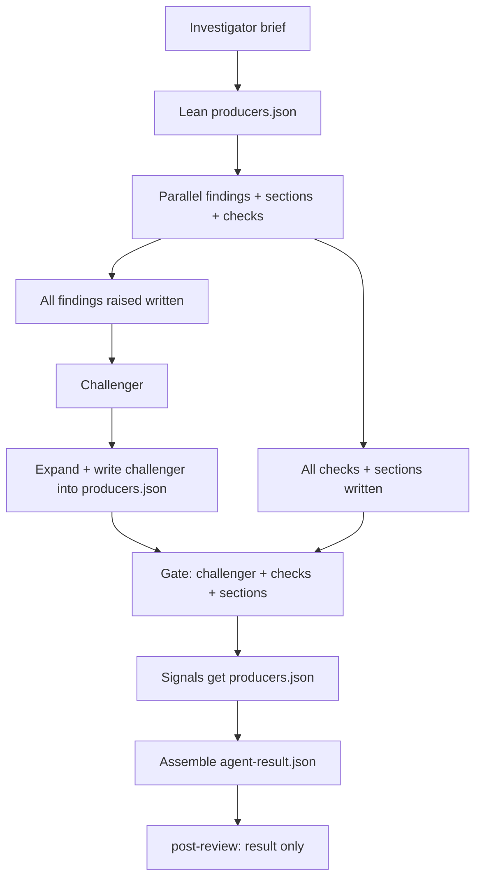

# PR review architecture

Architecture and workflow for Fullsend PR review in this repository.
[`SKILL.md`](SKILL.md) is the orchestrator runbook: it dispatches by **output
kind** only and must not special-case producer names. Named inventory (labels,
dimensions, schema fields, disposition) lives here and in the linked registry /
schema / host scripts.

**Maintenance:** when changing labels, dimensions, the result schema,
meta-prompts, sticky layout, or host disposition, update this file in the same
change set.

## Pipeline

1. A GitHub event matches a **review** trigger listed under [Invocation](#invocation).
2. `pre-review` validates the registry, runs the host adapters in parallel
   (see [Host adapters](#host-adapters)), and aggregates their trusted JSON
   from `.fullsend/.run/` into `collected.json`. The orchestrator never
   invokes those CLIs itself.
3. The orchestrator reads [`.fullsend/dimensions.json`](../../dimensions.json),
   selects rows by `dispatch` / `when` / `re_review`, and writes a lean
   `producers.json` ledger before results are known. A **`context`** LLM row
   with `stage: pre-dispatch` runs here, alone; its brief is written under
   `context/` and every later LLM reviewer is told to read it. The
   challenger is not.
4. Selected **`findings`**, **`section:*`**, and **`check:*`** LLM rows run
   **together** (required). CLI **`findings`** / **`context`** envelopes are
   loaded from disk; adapter status is transferred into `producers.adapters`.
   As each return arrives, the orchestrator rewrites `producers.json`
   (`raised`, checks, sections, `returned`).
5. After **all findings** are raised, the **challenger** adjudicates the
   merged findings set only. The orchestrator expands stub
   `removed_findings` and writes the expanded `challenger` object into
   `producers.json` (checks/sections may still be in flight).
6. After challenger + all sections + all checks, every selected
   **`signal:*`** row runs with the **`producers.json` path** (file contract:
   ledger + raised history + checks/sections + challenger). Shared output
   contract: [`signal-output.md`](../../meta-prompts/signal-output.md).
7. The orchestrator synthesizes `todo[]`, assembles `agent-result.json` from
   `producers.json` (including `result.producers`), and validates.
8. [`post-review.sh`](../../scripts/post-review.sh) reads **`agent-result.json`
   only**, computes internal `action`, renders the sticky comment body, posts
   the GitHub review, and applies at most one outcome label.



### Sticky comment order

Visible layout, in order (heading levels matter):

1. Header (action, head SHA, run metadata)
2. `## Change summary`
3. `## Status` (headline), immediately followed by:
   - `### Signals` (risk / confidence table — always present on non-failure)
   - `### Checks` (readiness table; omit when empty)
4. `## Findings` when survivors or justified items exist (severity groups,
   then `### Justified` when present). On `approve` with neither, the host
   renders “Looks good to me.” instead of a Findings section.
5. `## Product ask` (omit when `status` is `none`)
6. `## TODO` (omit when empty; plain-text category labels Findings / Checks /
   Judgement / Nits — not markdown headers)
7. Collapsed **Review details**: Producers, Challenger (counts + removed
   audit), Evidence inspected, Labels

### Producers table

Host-rendered provenance under Review details. Sourced from
`result.producers` only (no side ledger / `collected.json` at post time).

| Column | Meaning |
| --- | --- |
| Producer | Human `label` from [`dimensions.json`](../../dimensions.json) (fallback: registry id) |
| Type | Lowercase output kind: `findings`, `check`, `signal`, `section`, `context` (unknown → `—`) |
| Ran | Dispatch / adapter status icon (see below) |
| Result | Kind-aware one-line outcome (not a second Status table) |

**Type resolution:** registry `output` for the dimension id. Collapse
`check:*` / `signal:*` / `section:*` to the prefix before `:`.

**Result by Type:**

| Type | Result cell |
| --- | --- |
| `findings` | As-raised from `producers.raised.<id>`: `N findings: cat1, cat2` or `No findings.` (not post-challenger survivors) |
| `check` | `pass — <summary>` (status + summary); skipped rows use the skip reason |
| `signal` | `risk high · confidence medium` from `result_fields` levels (no `why` prose) |
| `section` | e.g. `product_ask aligned` from each `result_fields` member’s `status` |
| `context` | `Context available.` / adapter reason token / unavailable defaults |
| skipped / unverified | Skip or unverified reason in Result; Type still resolved when known |

Check and signal Result cells intentionally overlap Status → Checks / Signals
for provenance. Status remains the primary outcome surface.

**Challenger audit:** when `producers.challenger.removed_findings` is
non-empty, a collapsed section under Challenger renders non-justified items
like findings, with an audit-only / must-ignore disclaimer and each
`removal_reason`. Disposition and `## Findings` use survivor `findings[]`
only. Host warns if `challenger.removed` ≠ audit list length.

**Justified findings:** items in `removed_findings` with
`challenger_action: justified` are rendered under `## Findings` →
`### Justified (N)` (after the severity groups), not in the Challenger
removed audit. Each shows the original severity, description, and
`removal_reason` labeled as a justification. A fixed disclaimer notes
these do not block disposition. The section is delimited by the
`### Justified (N)` heading; do not wrap it in an HTML comment.
`fullsend post-review` escapes comment openers in agent-authored bodies,
so a wrapper would show as visible text in the sticky.

### Author rebuttals (Justifications vs Evidence)

Authors can rebut review pressure in two separate places in the PR body.
They are **not** interchangeable:

| Channel | Where authors write | How it is used |
| --- | --- | --- |
| **Challenger** (findings) | `## Justifications` | If a justification adequately rebuts a finding against the diff, the challenger marks it `challenger_action: justified` and it follows the removed path — visible under `### Justified` with the challenger's reason, but not disposition-blocking. Insufficient justifications leave the finding at its original severity. Host policy categories (`protected-path`, `approach-rejected`) cannot be justified; the host restores them into `findings[]` if mistagged. |
| **test-impact** (check) | Typically `## Evidence` | A sufficient **Automation** constraint justification (why automation could not or should not be added, and what alternative verification exists) moves Automation to ⚠️ instead of ❌; it does not waive Efficiency, which needs its own rationale explaining why unit tests are inappropriate and the chosen tier is correct. When Automation is ⚠️ solely because there are no tests, Efficiency stays ➖. The waiver does not satisfy Evidence depth: proof is still required, either from required-CI suites covering the changed packages or, for what CI cannot show, from the description. |

These rebuttals are **not** a shared ruleset applied to every producer.
Rating, pr-description-review, and other producers are not affected.
Product-ask already has its own `mismatch-justified` path.

Producer **Ran** icons (`result.producers`):

| Icon | Meaning |
| --- | --- |
| ✅ | Ran (LLM dispatched, or adapter `status: ok` on `producers.adapters`) |
| ⚪ | Adapter unavailable (`none` / `skipped` — not a clean zero-finding run) |
| ❌ | Adapter `status: error` |
| ➖ | Orchestrator skipped (out of scope / re_review) |
| ❔ | Missing `result.producers`, missing adapter status, or unrecognized status |

## Labels

| Label | Applied by | Role |
| --- | --- | --- |
| `ready-for-review` | Humans / process | On a non-draft PR, a `labeled` event with this label starts a **review** run. Still stripped from agent `label_actions`. |
| `fullsend-no-fix` | Humans or `/fs-fix-stop` | Disables the fix agent. |
| `fullsend-fix` | Fix control | Fix-agent marker. Not set via agent `label_actions`. |
| `ready-for-merge` | Host (post-review) | Internal `approve`, not draft, not a protected-path downgrade. Merge remains a separate step. |
| `requires-manual-review` | Host (post-review) | Internal `comment`, or approve downgraded for draft / protected paths. |
| `rejected` | Host (post-review) | Internal `reject` from finding category `approach-rejected`. PR is closed. |

Internal `request-changes` (blocking findings **or** a check with `status:
fail`) posts GitHub `CHANGES_REQUESTED` and applies **no** outcome label. Sticky
Status uses “Waiting on author” prose.

Control labels that must not appear in agent `label_actions`:
`ready-for-merge`, `requires-manual-review`, `rejected`, `ready-for-review`,
`fullsend-no-fix`, `fullsend-fix`.

### Internal action vs GitHub review vs outcome label

| Internal `action` | Typical sticky Status | Outcome label | GitHub review |
| --- | --- | --- | --- |
| `approve` | Agent bar cleared | `ready-for-merge` (unless draft / protected-path downgrade → `requires-manual-review`) | APPROVE |
| `comment` | Needs judgment / cannot approve | `requires-manual-review` | COMMENT |
| `request-changes` | Waiting on author | none | CHANGES_REQUESTED |
| `reject` | Approach rejected | `rejected` | reject path + close |
| `failure` | Review did not complete | none | failure comment |

## Disposition rules

### Findings

Host blocking: the severities in `blocking_finding_severities`, except
categories excluded in [`.fullsend/rating-policy.json`](../../rating-policy.json).
`human_judgment_finding_severities` do not block but yield `comment` / needs
judgment; `low` / `info` can ride with `approve`. Category `approach-rejected`
→ `reject`.

### Checks

| Check `status` | Host disposition |
| --- | --- |
| `pass`, `warning`, `not-applicable` | No effect on `action` |
| `fail` | `request-changes`; refuse approve |
| `could-not-verify` | Refuse approve; `comment` → `requires-manual-review`; also caps high confidence via incompleteness |

### Adapters

| Adapter `status` | Host disposition |
| --- | --- |
| `ok`, `skipped`, `none` | No effect on `action` |
| `error` | Refuse approve; `comment` → `requires-manual-review`; caps high confidence; Status headline names producer(s) + reason |

An adapter with `status: ok` and empty `findings` is a successful empty
review — it can ride with `approve`. An adapter with `status: error` means
the pipeline did not complete (e.g. rate limit, CLI failure); the host
refuses approve regardless of findings.

#### Test impact vs PR description (Evidence)

| Check | Role |
| --- | --- |
| `pr-description-review` | Surface: Problem / Solution / Evidence — is meaningful test evidence present on the face of the PR body? |
| `test-impact-review` | Depth: **Automation**, **Efficiency**, **Evidence depth** — durable automation (incl. edge cases); efficient tier (unit over Cypress mock; heavy Cypress / unit-light fails unless the description justifies); dig into proof so it covers the change and protects integrity while tests stay green. Suites exercised by required PR status checks need no description call-out; missing author-supplied proof for what required CI cannot show → Evidence depth `fail` even if tests exist in the tree. |

`test-impact-review` may return **`fail`**, which maps to `request-changes`. Per-aspect N/A: Automation/Efficiency may be N/A for non-product-code heads (lockfile/manifest/docs with nothing to unit-test), or when there are no tests to evaluate for Efficiency; **Evidence depth remains required** for those heads, satisfied by required-CI coverage or — for non-behavioral edits such as localization strings, docs, or formatting — an explicit scope statement (e.g. “localization only; no behavior change”). The check does not inspect current CI status; the merge gate enforces it. Do not N/A the whole check solely because the change is non-code.

Committed tests that exercise the changed scenario are runtime evidence: the check judges their steps and assertions, not whether they have executed. Required-CI status checks and the merge gate own execution, so an unrun or not-yet-green test is not an evidence gap.

### Signals (`risk` / `confidence`)

Refuse approve (→ `comment`, not `request-changes`) when levels match
`rating-policy.json` refuse sets. Host may still floor confidence for product-ask
mismatch or incomplete checks; it does not invent risk.

### TODO synthesis (orchestrator)

Closed recipe after the report is assembled (kind/status-driven, not producer-id
branches). Prefer `{category,text}` objects:

1. `findings` — findings that block or need judgment → remediation / location pointers
2. `checks` — check `fail` → that check’s summary
3. `judgement` — check `could-not-verify`, refuse-approve levels from `rating-policy.json`, section `needs_human` → concrete follow-ups
4. `nits` — one bullet per `low`/`info` finding with `actionable: true` (whenever
   such findings exist, not only on otherwise-approve paths)

Omit `todo` when empty. Sticky bullets only — no `[ ]` task-list syntax. Host
renders category labels as plain text (not markdown headers).

## Dimensions

### Output kinds

| `output` | Role | Timing | Meta-prompt |
| --- | --- | --- | --- |
| `findings` | Code defects → challenger | Parallel with sections + checks (LLM + CLI envelopes) | `findings-output.md` |
| `context` | Trusted host snapshot; or, with `stage: pre-dispatch`, an LLM brief every later reviewer reads | Host adapter; or alone, before dispatch | none; `context-output.md` for the LLM brief |
| `section:*` | Schema object (e.g. `product_ask`) | Parallel with findings + checks | `section-output.md` |
| `check:*` | Readiness row → `checks[]` | Parallel with findings + sections; before signals | `check-output.md` |
| `signal:*` | Schema members from `result_fields` | After challenger + all checks + all sections; gets `producers.json` | `signal-output.md` |
`result_fields` names the schema properties a `section:*` or `signal:*` row
projects onto the result. For `section:*`, if omitted, default to the name after
`section:`. For `signal:*`, `result_fields` is required.

### Registry inventory

Keep this table aligned with [`.fullsend/dimensions.json`](../../dimensions.json).
**Stock** = shipped in [fullsend-ai/agents `skills/pr-review`](https://github.com/fullsend-ai/agents/tree/2da538b8b62ad6d7b91c43d8cf139f4738cfbf51/skills/pr-review)
at harness pin `2da538b` (v0.48.1). Everything else is an ODH overlay producer.

| id | label | output | source | definition / runner |
| --- | --- | --- | --- | --- |
| investigator | Investigator | `context` (`stage: pre-dispatch`) | ODH | `sub-agents/investigator.md` |
| correctness | Correctness | `findings` | stock | `sub-agents/correctness.md` |
| security | Security | `findings` | stock | `sub-agents/security.md` |
| intent-coherence | Intent coherence | `findings` | stock | `sub-agents/intent-coherence.md` |
| style-conventions | Style conventions | `findings` | stock | `sub-agents/style-conventions.md` |
| style-review | Style | `findings` | ODH | `sub-agents/style-review/SKILL.md` |
| rbac-review | RBAC | `findings` | ODH | `sub-agents/rbac-review/SKILL.md` |
| docs-currency | Docs currency | `findings` | stock | `sub-agents/docs-currency.md` |
| cross-repo-contracts | Cross-repo contracts | `findings` | stock | `sub-agents/cross-repo-contracts.md` |
| jira-snapshot | Jira | `context` | ODH | `scripts/fetch-jira-context.sh` |
| coderabbit | CodeRabbit | `findings` | ODH | `scripts/fetch-coderabbit-context.sh` |
| product-ask-review | Product ask | `section:product_ask` | ODH | `sub-agents/product-ask-review/SKILL.md` |
| test-impact-review | Test impact | `check:test-impact` | ODH | `sub-agents/test-impact-review/SKILL.md` |
| pr-description-review | PR description | `check:pr-description` | ODH | `sub-agents/pr-description-review/SKILL.md` |
| rating | Rating | `signal:rating` (`risk`, `confidence`) | ODH | `sub-agents/rating.md` |

### Adding a producer

1. Add a definition under `sub-agents/` (or a host `scripts/*.sh` for
   `cli-adapter`).
2. Add a row to `dimensions.json` with the correct `output` kind, a human
   `label`, and `meta_prompt` / `result_fields` as required.
3. Run `.fullsend/scripts/validate-dimensions.sh`.
4. Update the inventory table above.

Do **not**:

- Add a per-producer output schema (reuse `check-output.md` / `signal-output.md`
  / `section-output.md` / `findings-output.md`).
- Teach [`SKILL.md`](SKILL.md) the new producer id (no “run rating”, no
  “if test-impact…” branches). Kind-level dispatch only.
- Route checks or signals through the challenger.

## Invocation

Workflow: [`.github/workflows/fullsend.yaml`](../../../.github/workflows/fullsend.yaml).
Fullsend reviews all **non-draft** PRs (no opt-in label). ODH differs from
stock Fullsend by skipping drafts on automatic PR events; use `/fs-review` to
review a draft. Job `if` filters admit:

**Review path** (`dispatch`, review stage; host adapters run in its pre-script):

- `pull_request_target` when **not draft**: `opened`, `synchronize`,
  `ready_for_review` (draft→ready), or `labeled` with `ready-for-review`
- issue comment body exactly `/fs-review` (non-bot) — runs even on drafts

**Fix path** (`dispatch`, fix stage; the fix harness has no host adapters):

- `pull_request_review` with state `changes_requested`
- issue comment starting with `/fs-fix` (but not `/fs-fix-stop`) from a non-bot

`/fs-fix-stop` is handled by the separate `stop-fix` job (adds
`fullsend-no-fix`). Closed/merged PRs are skipped by `pre-review` /
`post-review` gates. If a draft is reviewed via `/fs-review`, host outcome
labeling still downgrades `approve` → `requires-manual-review` instead of
`ready-for-merge`.

Local contract checks (no GitHub API):

```bash
.fullsend/scripts/validate-dimensions.sh
.fullsend/scripts/pre-review.sh --self-test
.fullsend/scripts/post-review.sh --self-test
```

### Host adapters

The `cli-adapter` rows (Jira, CodeRabbit) run on the host inside the review
job, in [`pre-review.sh`](../../scripts/pre-review.sh), after the PR-state and
skip-author checks:

- **Credentials.** The shim composes `FULLSEND_GITHUB_RUNNER_SECRETS` from the
  `CODERABBIT_API_KEY`, `JIRA_URL`, `JIRA_USERNAME` and `JIRA_API_TOKEN` secrets, and
  [`harness/review.yaml`](../../harness/review.yaml) references
  them in `env.runner` (Fullsend ADR 0136). Every name is always sent: an
  unset secret goes as the placeholder `odh-adapter-credential-unset`, because
  `fullsend run` refuses an unset reference and an empty value alike, and
  `pre-review.sh` reads the placeholder as empty. `pre-review.sh` unsets them before
  starting any child. Each adapter runs with an allowlisted environment (no
  review or GitHub token) and only the credentials its row names in
  `host.credentials`, under the generic `FULLSEND_ADAPTER_*` names. None of
  them reaches the sandbox. `env.runner` also reaches `post-review.sh`, which
  unsets them first, and the validation loop, which does not read them.
- **Jira URLs.** The review harness sets public `JIRA_BASE_URL` to the Jira site
  URL for browse links. `JIRA_URL` is passed only to the Jira adapter for REST
  requests when it is an Atlassian API gateway URL. Without that URL, the Jira
  snapshot reports `jira-api-url-unset`; it does not request from the site URL.
  The gateway does not appear in review links. [`post-review.sh`](../../scripts/post-review.sh)
  resolves each Product ask label from its own `.run/jira.json` snapshot rather
  than the section's `key`/`url`.
- **Order and cost.** `fullsend run` posts the review start-status comment
  before it runs the pre-script, so it is up before any adapter work. A closed PR or a
  skipped author exits before the adapters, so it buys no CodeRabbit run.
  Jira and CodeRabbit run at once; the review waits for the slower one
  (CodeRabbit, 20 minutes at most).
- **Failures.** An adapter that exits non-zero, or exits zero without writing
  its envelope, gets an `error` envelope (`adapter-exited-<code>` or
  `adapter-wrote-no-output`), so the Producers table shows it as errored. The review carries on without it; both adapter rows are
  `failure_severity: info`.
- **Cancellation.** The adapters share the review job's
  `cancel-in-progress` group, so a newer push cancels them with the review.
- **Stale context.** Head-dependent context is read from the forge when the
  pre-script runs, not from the event: `pre-review.sh` reads the head SHA,
  base, title and body with `gh pr view`, and CodeRabbit reviews that head SHA
  (Fullsend ADR 0106). A push after that point starts a new run, which cancels
  this one. If a run is not cancelled, its adapter context still describes the
  head the sandbox reviewed. Fullsend's steer and coalesce work (fullsend#7689
  follow-ups) can change this; recheck it when that lands.
- **Jira key selection.** [`fetch-jira-context.sh`](../../scripts/fetch-jira-context.sh)
  collects keys from the PR preamble (before the first Markdown heading),
  after stripping HTML comments so template placeholders in `<!-- ... -->`
  are ignored; if the preamble has none, it falls back to the
  comment-stripped title. Keys are deduplicated in encounter order and capped
  at 10 (`omitted_keys` records the rest). Fetches land in `issues[]` next to
  the backward-compatible top-level fields (first successful issue).
  `post-review.sh` surfaces failed keys/reasons and `omitted_keys` as an
  evaluation-limit notice under Product ask when that section is rendered.
- **Adding a credential.** Add the secret to the shim's `format(...)`
  expression with the same placeholder fallback, reference it in
  `env.runner`, add it to `post-review.sh`'s unset line, and name it in the
  row's `host.credentials`; `post-review.sh --self-test` checks all four. A name the reusable workflow sets itself (`JIRA_TOKEN`,
  `JIRA_USER_EMAIL`, `JIRA_BASE_URL`, any `FULLSEND_*` or `GITHUB_*`) is
  refused by `fullsend run`. `pre-review.sh` also refuses rows that name a
  variable the review needs or must not forward (`REVIEW_*`, `GH_TOKEN`,
  `PATH`, `PR_*`, …), and `post-review.sh` unsets the four names it never
  uses.

**Pipeline mode:** `FULLSEND_OUTPUT_DIR` is set. Orchestrator writes
`$FULLSEND_OUTPUT_DIR/agent-result.json` (omit `action` / `body` on success;
host fills both). Host `post-review.sh` posts and labels.

**Interactive mode:** `FULLSEND_OUTPUT_DIR` unset. Orchestrator posts via
`gh pr review` per `SKILL.md` (dev path; CI uses pipeline mode).

## Report schema

Canonical schema: [`.fullsend/schemas/review-result.schema.json`](../../schemas/review-result.schema.json).

| Field | Written by | Notes |
| --- | --- | --- |
| `pr_number`, `repo`, `head_sha`, `schema_version` | Orchestrator | Identity; `schema_version` is `"3"` |
| `change_summary` | Orchestrator | From shared PR context, not prior-review text |
| `findings[]` | Findings producers + challenger survivors | Disposition + sticky Findings |
| `producers` | Orchestrator (from `producers.json`) | Raised history, adapter status, challenger audit, ledger projection — omit working-store `checks`/`sections` (those become top-level); post-review does not re-read side files |
| `product_ask` | `section:product_ask` | Omit sticky section when `none` |
| `checks[]` | `check:*` rows | Readiness; disposition-affecting |
| `risk`, `confidence` | `signal:*` via `result_fields` | Sticky Signals table |
| `todo[]` | Orchestrator final pass | Sticky TODO by category; omit when empty |
| `inspected` | Orchestrator (+ host limits) | `summary` / `could_not_verify` only — no `producers` |
| `label_actions` | Optional enrichment | Control labels stripped by host |
| `action`, `body` | Host | Disposition + sticky markdown |

## Meta-prompts

For dispatched LLM producers, compose the kind contract after
`common-review.md`. Challenger guidance is spawn-only (not a producer
`meta_prompt`).

| File | Kind |
| --- | --- |
| [`common-review.md`](../../meta-prompts/common-review.md) | Shared preface for LLM producers |
| [`findings-output.md`](../../meta-prompts/findings-output.md) | `findings` |
| [`section-output.md`](../../meta-prompts/section-output.md) | `section:*` |
| [`check-output.md`](../../meta-prompts/check-output.md) | `check:*` |
| [`signal-output.md`](../../meta-prompts/signal-output.md) | `signal:*` (producer contract) |
| [`context-output.md`](../../meta-prompts/context-output.md) | `context` with `stage: pre-dispatch` (investigator brief) |
| [`challenger-justifications.md`](../../meta-prompts/challenger-justifications.md) | Challenger spawn-only: PR `## Justifications` → `justified` action |

## Upstream sync

Stock files track [fullsend-ai/agents](https://github.com/fullsend-ai/agents)
at `2da538b` (v0.48.1, 2026-10-17). The harness base in
[`harness/review.yaml`](../../harness/review.yaml) and the sandbox image are on
v0.48.1. The reusable workflow in
[`fullsend.yaml`](../../../.github/workflows/fullsend.yaml) is pinned to
fullsend `main` at `af8cd47`, just past v0.48.1, for the review-findings marker
fix (fullsend#8544); move it to v0.48.2 or later once that is released. The
three move together. v0.48 is the first release line that passes declared
secrets to host-side scripts (ADR 0136), keys skills on their declared
`SKILL.md` name, and refuses `host_files` under `/sandbox/workspace/.fullsend`,
so the registry and the adapter output reach the sandbox under
`/sandbox/workspace/odh-review/`.

Review models are named per persona under `agents[].subagents` in
[`config.yaml`](../../config.yaml), with the orchestrator on the agent's
`model:`. There are no `models.aliases`: v0.48 deprecates aliases that resolve
outside the Claude family, and they would also remap `opus`/`sonnet` for the
Claude Code roles.

| Path | State |
| --- | --- |
| `sub-agents/{challenger,correctness,cross-repo-contracts,docs-currency,intent-coherence,security,security-triage,style-conventions}.md` | Same text as upstream. `intent-coherence` brings the `scope-bundling` category, which its registry row lists |
| [`github/SKILL.md`](github/SKILL.md) | Same text as upstream. `SKILL.md` reads its commands by path; the base harness also loads it as the `pr-review-github` skill |
| [`references/re-review.md`](references/re-review.md) | Upstream text; categories map to dimensions through the registry instead of a fixed table |
| `issue-labels` | Not vendored. The base's `skills/issue-labels/github` loads: v0.48 keys skills on their declared name, so it no longer collides with `pr-review/github` |
| [`SKILL.md`](SKILL.md) | Local orchestrator. Carries upstream's time budget, runtime-aware dispatch, PR-head materialisation, commit-message and same-repository issue context for intent-coherence, challenger accounting and re-review contract, expressed through the registry |
| `scripts/pre-review.sh` | Rebased onto upstream's `2da538b` bundle; the bundled forge libraries are upstream text. Local additions (host-adapter registry and runner, dispatch normalisation, skip signal, registry-driven prior-review validation, self-test) sit on top; its header lists them |
| `scripts/post-review.sh` | Local script, derived from `bb167e2` (the last upstream revision before the multi-forge rewrite), plus four changes from `ce2eedd`: the prior-findings projection, `label_actions` hardening, the PR file-list retry, and a failed job when the result is a `failure`. Nothing later is carried; see below |

Not carried from that revision:

| Upstream change | Here |
| --- | --- |
| GitLab support (`pr-review/gitlab`, nested GitLab paths in `repo`) | GitHub only. `pre-review.sh` carries upstream's GitLab library as bundled, but its local steps call `gh`. |
| `risk-assessment` sub-agent, `pr-risk-assessment` skill, `risk_assessment` result field, the risk verdict gate (`REVIEW_RISK_VERDICT_THRESHOLD`) | Switched off in the harness. `risk` / `confidence` come from the `signal:*` row and `rating-policy.json`. |
| Finding-id ledger: `id` on findings, `dispositions`, minting ids for legacy markers, human dismissals from resolved review threads, `### Earlier findings`, original finding links | The host writes no ids and posts no inline threads, so the projection stays severity, category, file and line. The bundled forge helpers for it are unused. |
| Re-review severity gate (new low/info findings never start a fix; prior high/critical stay blocking; legacy or `reject` priors held for a human) | The host computes the action from `rating-policy.json`, where low/info never block. Carrying prior blockers forward needs the ledger. |
| A `protected-path` finding refuses approval even when `REVIEW_PROTECTED_PATHS` is empty | The host keeps a `protected-path` finding only when a changed file matches `REVIEW_PROTECTED_PATHS`, and routes it to human judgement. |
| Verdict keyed on `actionable` findings; review body formatting rules | The host computes the action and renders the body. |
| Per-dimension `pr_head` manifest subsets | The shared context file carries the full manifest for every reviewer. |
| A `low` finding when the time budget skips the challenger | `result.producers` records the skip and the host renders it. |
| Resolving outdated review threads on re-review | Not needed: reviews here are summary-only, with no inline threads. |
| `validation_loop.max_iterations: 1` | The harness keeps 2. |

### Re-review data flow

1. `post-review.sh` writes one `<!-- fullsend:review-findings-v2:<base64> -->`
   marker as the first line of every review body it renders. Its payload is the severity,
   category, file and line of each finding that a registry row owns. When a
   finding cannot be represented (a category no row lists) or a dimension
   failed, the payload is a withheld sentinel instead, so the next run reviews
   from scratch.
2. The workflow fetches the prior sticky comment and checks who wrote it.
3. `pre-review.sh` accepts the comment only when it holds exactly one marker
   and no sticky-history delimiter, validates the payload against the registry
   categories, and rewrites `prior-review.txt` to JSON before the sandbox
   starts. Prose from the earlier review never enters the sandbox. This needs
   `keep_history: false` in `config.yaml`.
4. The orchestrator follows [`references/re-review.md`](references/re-review.md).

Reviewers are given their row's `categories` as `Allowed categories`, and the
orchestrator relabels a stray category within its row at collect, because one
unlisted category withholds the whole projection.

The first re-review of a PR whose sticky comment predates the marker runs as a
first review.

## Tracing

Fullsend on the Pi runtime exports only `run`, `sandbox_create` and `agent` spans.
[`fullsend-trace.yaml`](../../../.github/workflows/fullsend-trace.yaml) runs after each
`fullsend` run completes (`workflow_run`, or a manual dispatch with a past run ID to
backfill). It downloads that run's `fullsend-review` artifact and
[`trace-bridge.py`](../../scripts/trace-bridge.py) sends spans to MLflow under the run's own
trace ID.

**Setup.** Repo variable `FULLSEND_TRACE_OTLP_ENDPOINT` (`<mlflow>/v1/traces`; RHOAI
MLflow 3.17+ serves it at `<route>/mlflow/v1/traces`), and an environment
`fullsend-trace` whose deployment branches are limited to the default branch, holding the
secret `FULLSEND_TRACE_OTLP_HEADERS` (`Authorization=Bearer%20<token>,x-mlflow-experiment-id=<id>`,
plus `X-MLFLOW-WORKSPACE=<namespace>` for RHOAI). Keep the secret only in that environment,
never as a repository secret: anyone who can push a branch could dispatch an edited copy of
this workflow or the bridge from it and read a repository secret. Use a credential that can only write
traces to one experiment. The endpoint must be `https` (plain `http` only for localhost),
and redirects are not followed. Without the variable the job is skipped. The bridge
re-sends Fullsend's run and agent spans, so Fullsend's own
`OTEL_EXPORTER_OTLP_TRACES_ENDPOINT` can stay unset. If Fullsend exports its own spans later,
add `--no-base-spans` (or use `recover: bridge-only`).

**Exported data.**

| Span | Contents |
| --- | --- |
| `persona <name>` | Sub-agent model, cost, tokens, duration, stop reason, tool counts, files read by category, guidance opened and missed |
| `execute_tool <name>` | Tool name, repo-relative path, search pattern, or for shell commands the programs run and paths named; duration, result size, error |
| `context_coverage` | Rules/ADRs that apply to the PR (`fetch-guidance-context.sh`), which were opened, which were missed |
| `review_result` | Verdict, finding counts, risk, confidence, dispatched/skipped producers, adapter status, real cost |

Trace tags (`fullsend.pr`, `fullsend.verdict`, `fullsend.cost_usd`,
`fullsend.guidance.coverage`, …) make the MLflow trace table filterable. MLflow's own cost
column ignores cache discounts; use `fullsend.cost_usd`.

"Opened" means a successful `read`, or a file argument to `cat`/`head`/`sed`-style programs
in a shell command whose success is established: it is in the command's last list
(after the last `;` or newline), joined only by `&&`, and not piped into another command.
Searches, failed reads, paths that only appear in prompts, redirection targets
(`cat > f`), heredoc bodies, reads masked by a later command (`cat f; ls`), an `||`
fallback (`cat f || true`) or a pipe (`cat f | head`), negated pipelines (`! cat f`,
`! true | cat f`), background jobs (`cat f &`), input redirections to programs that
don't show the file (`grep -q x < f`), reads whose output is sent away (`cat f >/dev/null`,
`cat f >& file`, `cat f 2>/dev/null 1>&2`; redirections are followed in order), `sed -i`, bodies of functions that may never be called (`f() { cat f; }`), and
anything after an `exit` that may have ended the shell (`exit 0`, `exit`, `exit $x`; a literal
nonzero `exit 1` can't have, in a command that succeeded) do not count. Relative paths are resolved against
a top-level `cd` whose success is established (by the same rule); after any other directory change they are dropped. Coverage needs
`.fullsend/scripts/fetch-guidance-context.sh`, and is scored against the files of the
reviewed commit: when the selector is missing, or the PR head has moved past that commit
(a later push or a backfill), the trace is sent without `context_coverage` data.

**Trust and retention.** The artifact is untrusted (the sandbox read PR code), so it is only
parsed as JSON; nothing from it is executed or interpolated into a shell. The job checks
out the default branch only, without persisted credentials, and its token has `actions`,
`contents` and `pull-requests` read access. Exported data excludes file contents, model
messages, prompts and tool results; only paths, search patterns and an allowlist of tool
arguments leave the artifact. Shell command text is never exported: a command becomes the
list of programs it runs plus the files it reads with a read program (`cat`, `head`,
`sed`, …) or redirects to or from. Other arguments, including those of `git`, `grep` and
`echo`, quoted text, heredoc bodies and inline scripts, stay behind. Fields from the sandbox (`agent-result.json`,
transcripts, usage) are checked for shape and dropped when malformed; numbers must be
finite. Credential-looking values, text under sensitive key names and `--token`-style
flags are redacted, including in span names and attribute keys. Fullsend's own spans keep
only IDs, name, kind, times, status code and an allowlist of metadata attributes (model,
token counts, cost, tool-call and turn counts, harness, mint and HTTP status); content
attributes such as `gen_ai.output.messages`, events, links and status messages are dropped.
They must sit in the host's run directory with well-formed IDs. Strings
are capped at 1,000 characters. What MLflow keeps follows the MLflow instance's own
retention; anyone who can read the experiment can read these traces.

**Failure behavior.** The job runs outside the review, so it cannot change a review's
outcome. Only runs of this repository's `.github/workflows/fullsend.yaml` for events that use the
base repository's definition (`pull_request_target`, `issue_comment`, `issues`,
`workflow_dispatch`, `schedule`; all but `pull_request_target` must run from the default
branch, and a `pull_request_target` run's PR must target it and not have been retargeted since
the run started, since a run from another ref
or a PR into another branch could use an edited file) are traced; a fork PR could edit that file and run it on
`pull_request` or `pull_request_review`, so those runs are skipped. A run whose artifact
list has no `fullsend-review` artifact is skipped; an
artifact API or download error fails the job so it can be rerun. On a rerun (`run_attempt` > 1) the reviewed commit is unknown, because the review
fetched the PR's head when it ran, so the commit, coverage and verdict are left out. The PR identity comes from a `pull_request_target`
Fullsend run's own head commit, repository and branch, which must match exactly one PR
(comment- and review-triggered runs report the default branch, so they carry none); the bridge gets it as
`--pr-number` and ignores the PR fields the sandbox wrote. There are two stages. The
trust check before the download (trusted workflow, event, branch and, for
`pull_request_target`, a single default-branch PR not retargeted since the run) skips the
trace when its answer is negative: the job succeeds and nothing is exported. A GitHub API
error during that check fails the job instead, so it can be rerun. After that, the PR metadata
lookups are optional: without a single match, or when a lookup fails, the trace is still
sent, just without PR identity or the missing metadata. The reviewed commit (`fullsend.head_sha`) comes from the
same run, and `fullsend.verdict` only from the Fullsend bot's review posted during it; the
artifact's `action` is exported separately as `fullsend.verdict.claimed` (for example
`failure`, which posts no review). The matched PR must also contain the reviewed commit. A failed PR, files, run
or review lookup only drops that optional metadata (author, coverage, posted verdict);
the spans are still sent. If guidance selection fails, the trace is sent without coverage.
If the endpoint is unreachable, the job fails and the review is unaffected; rerun it from
the Actions tab. If the bridge's spans are already in MLflow (its `fullsend.bridge.version`
tag is set, or the `fullsend.pr` tag that bridge version 1 used as its marker), a rerun
only refreshes tags, because re-sending spans doubles MLflow's token
totals. An export the endpoint only partly accepts (HTTP 200 with
`partialSuccess.rejectedSpans`) fails the job without writing the marker, and so does a
marker write that keeps failing after an export. A rerun then finds the trace without the
marker and stops rather than guess which spans MLflow holds. Check the trace, then run the
workflow manually with `recover`: `mark-only` records the marker when the spans are
complete (it stops if MLflow doesn't have the trace), `resend` sends all spans again (the ones already accepted count twice, so never use it on a
trace that already has either bridge marker), and
`bridge-only` adds only the bridge's spans to a trace Fullsend exported itself (it stops if
MLflow doesn't have the trace yet). Use
`bridge-only` only when the bridge never sent to that trace: after a bridge export whose
marker write failed it would send the bridge spans twice, so use `mark-only` there. To
back this up, a bridge-only export records `fullsend.bridge.pending` on the trace before
sending, failed or timed-out exports and marker writes try to record it too (best effort: if
MLflow rejects that tag write as well, check the trace before choosing `bridge-only`), and `bridge-only` refuses
a trace that has it. A
malformed `agent-result.json` doesn't stop the export and doesn't affect the PR identity,
author, coverage or posted verdict: in the workflow those come from the run and GitHub (the
bridge's own `shared.md` fallback is only for runs without `--pr-number`). It only loses the
artifact's own fields, such as the claimed verdict, risk and findings. A lookup that keeps failing (non-404 error, timeout, malformed reply) is retried
and then stops a normal run instead of exporting; rerun it. `recover: resend` goes
ahead even when the lookup keeps failing; `recover: mark-only` doesn't, because it needs the
lookup to confirm the trace is in MLflow. The bridge's run summary in the Actions log has counts and tags
only, never the PR, run URL, file or guidance paths (missed guidance is a count); the
workflow's own notices can still name a run ID or PR number.

## CodeRabbit coexistence

CodeRabbit (the org-wide GitHub App) is **not** a peer reviewer here.
Its auto-review is disabled to avoid duplicate review noise.

### What still works

- **CLI findings** — active via the Fullsend adapter
  (`coderabbit review --agent --deep --remote`)
- **Chat commands** — `@coderabbitai` works for ad-hoc queries
- **On-demand pre-merge checks** — `@coderabbitai run pre-merge checks`

### What is disabled

- **Auto-review comments** — no review body or inline comments from
  CodeRabbit on PRs
- **Automatic pre-merge checks** — coupled with auto-review in
  CodeRabbit, cannot be split. These were warning-only and not gating.
  Migration to Fullsend `check:*` producers is tracked separately.

### CodeRabbit architecture

```
PR opened/updated (non-draft)
       |
       +--> Fullsend (review-of-record)
       |       +-- CodeRabbit CLI adapter (.fullsend/scripts/)
       |       +-- Other dimensions (.fullsend/dimensions.json)
       |       +-- Posts single sticky review
       |
       +--> CodeRabbit App (auto-review: DISABLED)
               +-- No review comments posted
               +-- Chat commands still work on-demand
```

### CodeRabbit config reference

- `.coderabbit.yaml` — repo-level CodeRabbit config (auto-review disabled)
- `.fullsend/dimensions.json` — dimensions including CodeRabbit CLI adapter
- `.fullsend/scripts/fetch-coderabbit-context.sh` — CLI adapter script
- Org baseline: `opendatahub-io/coderabbit/.coderabbit.yaml`

## Related files

| Path | Role |
| --- | --- |
| [`SKILL.md`](SKILL.md) | Orchestrator runbook (kind dispatch) |
| [`github/SKILL.md`](github/SKILL.md) | GitHub commands the runbook runs (fetch, materialise PR head, compare) |
| [`references/re-review.md`](references/re-review.md) | Prior-findings and remediation-candidate rules |
| [`.fullsend/dimensions.json`](../../dimensions.json) | Producer registry |
| [`.fullsend/rating-policy.json`](../../rating-policy.json) | Host risk/confidence floors and blocking severity |
| [`.fullsend/scripts/post-review.sh`](../../scripts/post-review.sh) | Action, sticky, labels, self-tests |
| [`.fullsend/scripts/pre-review.sh`](../../scripts/pre-review.sh) | Host preflight / adapter prep |
| [`.fullsend/scripts/validate-dimensions.sh`](../../scripts/validate-dimensions.sh) | Registry contract |
| [`.github/workflows/fullsend.yaml`](../../../.github/workflows/fullsend.yaml) | Event routing |
| [`.github/workflows/fullsend-trace.yaml`](../../../.github/workflows/fullsend-trace.yaml) | Post-review trace export to MLflow (see [Tracing](#tracing)) |
| [`.fullsend/scripts/trace-bridge.py`](../../scripts/trace-bridge.py) | Turns a `fullsend-review` artifact into OTLP spans; `--self-test` |
