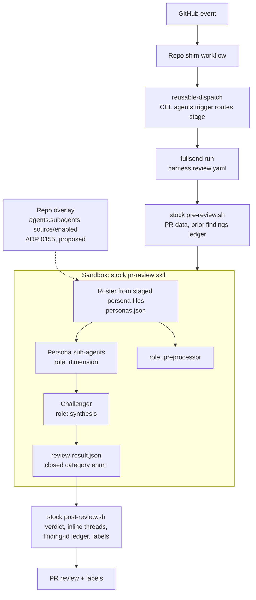
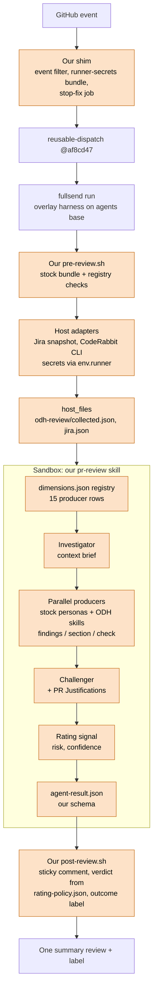
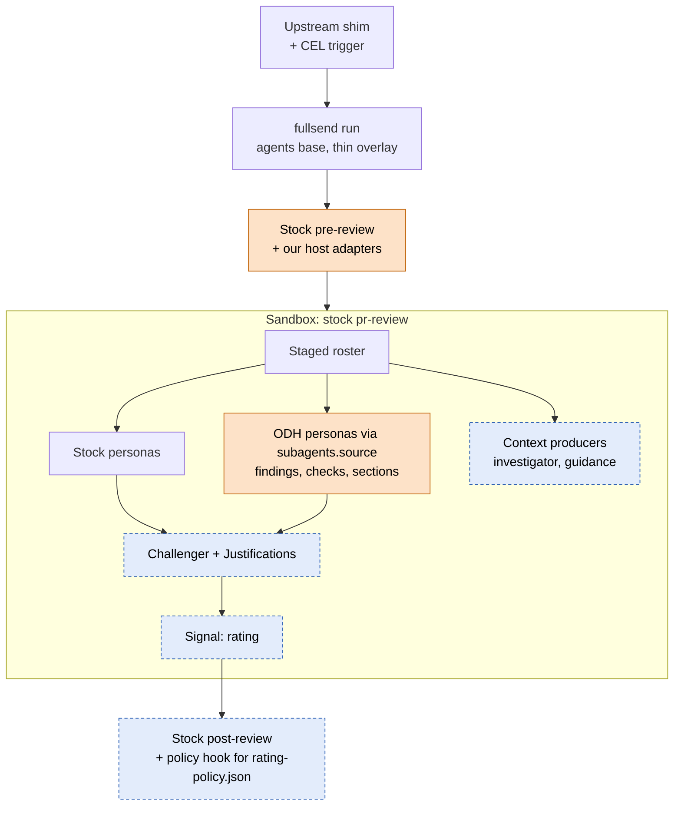

# Fullsend architecture: odh-dashboard vs upstream

How our Fullsend PR review is built, how upstream Fullsend is built, and where
the two diverge. This page is the source of truth for that comparison.

- Tracker: [RHOAIENG-100804](https://redhat.atlassian.net/browse/RHOAIENG-100804)
  (epic [RHOAIENG-100796](https://redhat.atlassian.net/browse/RHOAIENG-100796)).
- Upstream: [fullsend-ai/fullsend](https://github.com/fullsend-ai/fullsend)
  (CLI, reusable workflows, ADRs) and
  [fullsend-ai/agents](https://github.com/fullsend-ai/agents) (harnesses,
  stock skills).
- Maintenance: a daily sync run keeps one draft PR open titled
  "Fullsend upstream sync". It updates this page when upstream or our plan
  changes, moves our pins forward, and posts to the Monarch channel only when
  something needs the team. Details of the pipeline itself live in
  [`.fullsend/skills/pr-review/README.md`](../.fullsend/skills/pr-review/README.md).

## Pins and drift

As of 2026-11-03.

| Piece | Ours | Upstream latest release | Upstream `main` |
| --- | --- | --- | --- |
| `fullsend` reusable workflow / CLI | `af8cd47` (v0.48.1 + fullsend#8544) | v0.53.0 (2026-10-30) | 809 commits ahead of ours |
| `agents` review harness `base:` | `2da538b` (v0.48.1) | v0.53.0 | 327 commits ahead of ours |
| Sandbox image | v0.48.1 digest, Pi 1.3.0 | v0.53.0, Pi 1.3.0 | Pi 1.5.0 proposed (fullsend#9000) |

The three pins move together. A newer CLI on the old sandbox image is not
supported.

## Upstream today

Upstream's review is one stock skill (`pr-review`) in the sandbox. The
runner stages it, the orchestrator dispatches persona sub-agents, a
challenger filters findings, and the stock `post-review.sh` posts the review,
inline threads and labels. On `main` (not yet in a release), the roster comes
from staged persona files, and a repo can add, replace or disable a persona by
overlaying single files instead of forking the skill.

## Ours today

We replace the whole `pr-review` skill with a registry-driven orchestrator,
run credentialed adapters on the host, and render the result ourselves.
Everything in the shaded boxes is ours.

Producer kinds in the registry today:

| Kind | Rows | Output |
| --- | --- | --- |
| Context (`llm-subagent`, pre-dispatch) | investigator | Brief read by every reviewer except the challenger |
| Stock personas (`llm-subagent`) | correctness, security, intent-coherence, style-conventions, docs-currency, cross-repo-contracts | Findings |
| ODH skills (`llm-skill`) | style-review, rbac-review | Findings |
| ODH skills (`llm-skill`) | product-ask-review | `section:product_ask` |
| ODH skills (`llm-skill`) | test-impact-review, pr-description-review | `check:*` readiness rows |
| Host adapters (`cli-adapter`) | jira-snapshot, coderabbit | Context, findings |
| Signal (`llm-subagent`) | rating | Risk and confidence that gate approval |

## Where we diverge

Classification follows the epic: **Adopt** upstream's behaviour, **Propose**
ours upstream, or **Keep** ours behind a named upstream customisation point.

| # | Area | Upstream | Ours | Class | Customisation point / next step |
| --- | --- | --- | --- | --- | --- |
| D1 | Review skill | Stock `pr-review`; on `main` the roster is built from staged persona files ([agents#1858](https://github.com/fullsend-ai/agents/pull/1858)) | Local `SKILL.md` replaces the whole skill (skills merge by name, so we could not append) | Keep, then shrink | File overlays ([fullsend#8970](https://github.com/fullsend-ai/fullsend/pull/8970), main) and `agents[].subagents.{source,enabled}` ([ADR 0155, fullsend#8969](https://github.com/fullsend-ai/fullsend/pull/8969), open) cover finding personas only. See D2 |
| D2 | Producer registry | ADR 0155 explicitly rejects "a registry file in the skill" | `dimensions.json`, 15 rows, 5 output kinds | Propose | Ask ADR 0155 for non-finding roles (context, check, section, signal, adapter). Move finding rows to persona frontmatter (`role`, `when`, `categories`) once it ships |
| D3 | Stock personas | Upstream files, now with roster frontmatter | 8 files copied verbatim at v0.48.1 | Adopt | Drop our copies once D1 uses the base skill |
| D4 | Investigator | `role: preprocessor` slot exists | Registry `context` row, brief to all but challenger | Adopt | Map to a preprocessor persona; check that the brief still skips the challenger |
| D5 | Challenger and `## Justifications` | Challenger is `role: synthesis`, no author rebuttal input | Challenger reads PR `## Justifications`, marks findings `justified` | Propose | Upstream issue: author justification channel for synthesis |
| D6 | Risk and approval gate | `risk-assessment` sub-agent and risk verdict gate; per-tier sub-scores proposed ([agents#1879](https://github.com/fullsend-ai/agents/issues/1879)) | `rating` signal plus `rating-policy.json`; upstream risk-assessment switched off | Keep (open decision O3) | Needs a `signal` producer role, or we adopt upstream's risk gate |
| D7 | ODH reviewer skills | Personas may only emit the closed category enum (72 values) | style-review, rbac-review, product-ask, test-impact, pr-description with registry categories and section/check outputs | Keep | Added personas via `source:` work for findings only; needs an extensible category namespace (D9) |
| D8 | Credentialed context (Jira, CodeRabbit) | No review context-provider hook planned; ADR 0141 snapshot is forge-only and unimplemented | Adapters in our `pre-review.sh`, secrets via `FULLSEND_GITHUB_RUNNER_SECRETS` (ADR 0136), output via `host_files` | Keep, propose hook | ADR 0136/0145 is the supported path and we are compatible. Upstream uses `JIRA_TOKEN`/`JIRA_USER_EMAIL`/`JIRA_API_URL`; we use `JIRA_USERNAME`/`JIRA_API_TOKEN` |
| D9 | Result schema | Closed `category` enum, optional `dimension`; auto-merge fields proposed ([agents#1790](https://github.com/fullsend-ai/agents/issues/1790)) | Own schema: `product_ask`, `checks`, `producers`, risk, confidence | Propose | Extensible categories and producer outputs; align field names with #1790 |
| D10 | Result rendering | Stock `post-review.sh` (2,230 → 2,725 lines since our pin): inline threads, ledger, threshold notice ([agents#1827](https://github.com/fullsend-ai/agents/pull/1827)) | Own ~3.9k-line `post-review.sh` forked from `bb167e2`: one sticky summary, host verdict | Keep (open decision O4) | Largest fork cost. Port small fixes; decide whether to converge |
| D11 | Outcome labels | Clears `ready-for-merge` at review start ([agents#1719](https://github.com/fullsend-ai/agents/pull/1719)) | Clears stale labels only at post time | Adopt | Port into our `pre-review.sh` |
| D12 | Re-review | Finding-id ledger, dismissals from resolved threads; trusted projection input proposed ([fullsend#8563](https://github.com/fullsend-ai/fullsend/issues/8563)) | `review-findings-v2` marker with severity/category/file/line, no ids | Keep | Watch #8563: it changes the marker contract we rely on |
| D13 | Event routing | CEL `agents[].trigger` in config (v0.50.0, [fullsend#8733](https://github.com/fullsend-ai/fullsend/pull/8733)) | Hand-written `if:` filter on the shim `dispatch` job | Adopt | Move the filter into `agents[].trigger` on bump |
| D14 | Stage gating | `roles:` no longer gates execution; use `agents[].enabled` ([fullsend#7786](https://github.com/fullsend-ai/fullsend/pull/7786), v0.51.0) | `roles: [review, coder]`, `code` disabled; shim filter keeps triage/retro/prioritize out | Adopt | Disable unused agents explicitly on bump |
| D15 | Models | Per-persona models; org uses an OpenAI gateway | Pi, GPT-6.1 Sol / GPT-6 Luna per persona, repo-secret OpenAI key | Keep | Aligned with upstream config; repo keys stay supported |
| D16 | Fork PRs | `/fs-fix` blocked on forks; Route skips read-only fork authors ([fullsend#8709](https://github.com/fullsend-ai/fullsend/issues/8709)) | 35 of 40 recent merged PRs come from forks | Propose | +1 #8709 with our numbers; fork fix needs an upstream design |
| D17 | Dependency scoping | Reviews only the PR's own commits on stacked PRs ([agents#1661](https://github.com/fullsend-ai/agents/pull/1661)) | Not carried (forked skill) | Adopt | Comes free with D1, or port |
| D18 | GitLab | Supported | GitHub only | Keep | No need |
| D19 | Upstream bugs we work around | `jira_base_url` not passed to the Review job; `postFailureNotice` escapes our leading marker. Both unfixed on `main` | Literal `JIRA_BASE_URL` in `env.runner`; marker on line 1 | Propose | File both upstream |

## Our roadmap

Planned changes on our side, and how each meets upstream.

| # | Plan | Tracker | Upstream fit |
| --- | --- | --- | --- |
| P1 | Guidance lane: reviewers read the `.claude/rules` and ADRs whose `paths:` match the change | [RHOAIENG-100801](https://redhat.atlassian.net/browse/RHOAIENG-100801) (pilot) | No upstream equivalent. Needs a context producer (D2, D8) |
| P2 | Deterministic checks (BFF config, flag defaults, operator RBAC) as producers | Pilot branch | Same direction as upstream's move from prose to scripts ([agents#1803](https://github.com/fullsend-ai/agents/issues/1803)); needs a `check` role |
| P3 | Soft-block until an area OWNER took part | [RHOAIENG-102089](https://redhat.atlassian.net/browse/RHOAIENG-102089) | Host policy; upstream has no OWNERS concept |
| P4 | Only critical/high block; medium goes to human judgement | [odh-dashboard#10539](https://github.com/opendatahub-io/odh-dashboard/pull/10539) | Local `rating-policy.json` |
| P5 | Jira-driven `/fs-code` on RHOAIENG | [Fork #111](https://github.com/Gkrumbach07/odh-dashboard/pull/111) | Upstream is moving Jira config under `tracking.jira` and `fullsend repos` ([fullsend#8906](https://github.com/fullsend-ai/fullsend/issues/8906)); authorization lists in [fullsend#8892](https://github.com/fullsend-ai/fullsend/pull/8892) (main); multi-record collision [fullsend#8961](https://github.com/fullsend-ai/fullsend/issues/8961) open. Overlaps jira-autofix |
| P6 | Open upstream proposals, then shrink the vendored skill | [RHOAIENG-100805](https://redhat.atlassian.net/browse/RHOAIENG-100805), [RHOAIENG-100806](https://redhat.atlassian.net/browse/RHOAIENG-100806) | D1, D2, D5, D9, D16, D19 |
| P7 | Weekly docs and guidance consistency agent | [RHOAIENG-100808](https://redhat.atlassian.net/browse/RHOAIENG-100808) | Could run as an upstream scheduled agent |

### Target shape

Where we want to land if upstream accepts the proposals: the stock skill and
renderer, with our producers as overlays and our adapters on the host.

Orange: ours. Dashed blue: needs an upstream change we propose.

## Open decisions

| # | Decision | Needed from | By |
| --- | --- | --- | --- |
| O1 | Comment on ADR 0155 ([fullsend#8969](https://github.com/fullsend-ai/fullsend/pull/8969)) before it merges: ask for non-finding producer roles and an extensible category namespace. Christian raised the gap in [#forum-fullsend-ai](https://redhat-internal.slack.com/archives/C0AL1K8E7MX/p1793387289662199) and asked Gage to review | Gage, Christian | Before #8969 merges (it has `ready-for-merge`) |
| O2 | Move our finding personas to upstream overlays once 0155 ships, or keep the forked skill | Monarch | After v0.54.0 |
| O3 | Keep the `rating` signal, or adopt upstream's risk-assessment gate | Christian, Gage | With O2 |
| O4 | Keep our sticky renderer, or converge on stock `post-review.sh` with a policy hook | Christian | With O2 |
| O5 | Meet Eder on carrying our review ideas upstream and the Jira→code rollout ([thread](https://redhat-internal.slack.com/archives/C0AL1K8E7MX/p1793653336518279)) | Gage, Christian | Open |

## Bump plan

Next safe slices, in order. The sync run does one or more per day and records
blockers here.

1. **v0.53.0 pins, together.** Move the reusable-dispatch SHA, the harness
   `base:` (SHA and `#sha256=`) and the sandbox image digest to v0.53.0.
   With it:
   - Disable unused agents with `agents[].enabled: false` (D14).
   - Diff our shim against upstream's `shim-per-repo.yaml` template
     (bot `/fs-` comments now pass) and keep `id-token: write` on `dispatch`.
   - Rebase our `pre-review.sh` edits onto the v0.53.0 bundle; re-test
     review-thread position fields (fullsend#8693).
   - Re-sync the 8 verbatim persona files; they now carry roster frontmatter
     that our orchestrator ignores.
   - Run `fullsend lint` on our harness.
2. **Port small upstream behaviour:** clear `ready-for-merge` at review start
   (D11), severity-threshold notice (D10).
3. **v0.54.0 or later:** evaluate persona overlays (O2), then route triggers
   through `agents[].trigger` (D13).

Blockers: none recorded yet.
