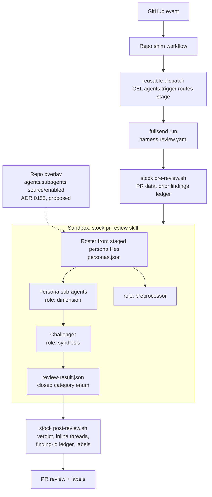
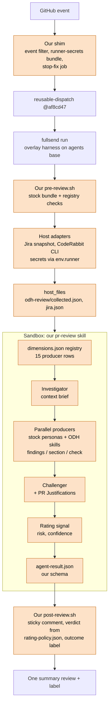
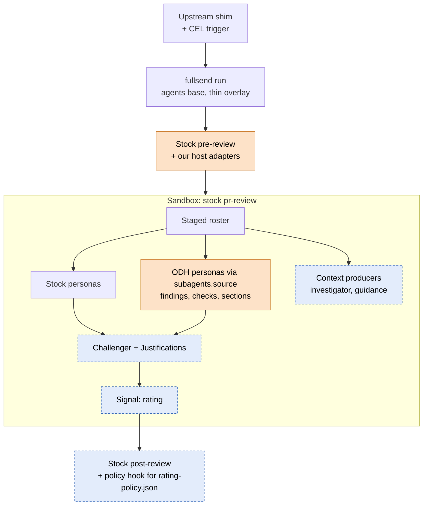

# Fullsend architecture: odh-dashboard vs upstream

How our Fullsend PR review is built, how upstream Fullsend is built, and where
the two diverge. This page is the source of truth for that comparison.

- Tracker: [RHOAIENG-100804](https://redhat.atlassian.net/browse/RHOAIENG-100804)
  (epic [RHOAIENG-100796](https://redhat.atlassian.net/browse/RHOAIENG-100796)).
- Upstream: [fullsend-ai/fullsend](https://github.com/fullsend-ai/fullsend)
  (CLI, reusable workflows, ADRs) and
  [fullsend-ai/agents](https://github.com/fullsend-ai/agents) (harnesses,
  stock skills).
- Maintenance: a daily sync run keeps one draft PR open titled
  "Fullsend upstream sync". It updates this page when upstream or our plan
  changes, moves our pins forward, and posts to the Monarch channel only when
  something needs the team. Details of the pipeline itself live in
  [`.fullsend/skills/pr-review/README.md`](../.fullsend/skills/pr-review/README.md).

## Pins and drift

As of 2026-11-05.

| Piece | Ours | Upstream latest release | Upstream `main` |
| --- | --- | --- | --- |
| `fullsend` reusable workflow / CLI | `af8cd47` (v0.48.1 + fullsend#8544) | v0.54.0 (`90b7310ff`, 2026-11-03) | 890 commits ahead of ours |
| `agents` review harness `base:` | `2da538b` (v0.48.1) | v0.54.0 (`87a43fcb`) | 361 commits ahead of ours |
| Sandbox image | v0.48.1 digest, Pi 1.3.0 | v0.54.0, Pi 1.3.0 | Pi 1.5.0 (merged, fullsend#9106, undici crash fix) |

Our vendored stock personas track v0.54.0; the three pins above still sit at
v0.48.1 and move together next.

The three pins move together. A newer CLI on the old sandbox image is not
supported.

## Upstream today

Upstream's review is one stock skill (`pr-review`) in the sandbox. The
runner stages it, the orchestrator dispatches persona sub-agents, a
challenger filters findings, and the stock `post-review.sh` posts the review,
inline threads and labels. As of v0.54.0 the roster is built from each persona
file's frontmatter, and a repo can add, replace or disable a persona by
overlaying single files from a `base:` harness instead of forking the skill
([fullsend#6158](https://github.com/fullsend-ai/fullsend/pull/6158)). A
config-level form (`agents[].subagents.{model,source,enabled}`, no custom
harness) is proposed in ADR 0155 and still open.

## Ours today

We replace the whole `pr-review` skill with a registry-driven orchestrator,
run credentialed adapters on the host, and render the result ourselves.
Everything in the shaded boxes is ours.

Producer kinds in the registry today:

| Kind | Rows | Output |
| --- | --- | --- |
| Context (`llm-subagent`, pre-dispatch) | investigator | Brief read by every reviewer except the challenger |
| Stock personas (`llm-subagent`) | correctness, security, intent-coherence, style-conventions, docs-currency, cross-repo-contracts | Findings |
| ODH skills (`llm-skill`) | style-review, rbac-review | Findings |
| ODH skills (`llm-skill`) | product-ask-review | `section:product_ask` |
| ODH skills (`llm-skill`) | test-impact-review, pr-description-review | `check:*` readiness rows |
| Host adapters (`cli-adapter`) | jira-snapshot, coderabbit | Context, findings |
| Signal (`llm-subagent`) | rating | Risk and confidence that gate approval |

## Persona metadata vs our registry

As of agents v0.54.0 (agents [b714256](https://github.com/fullsend-ai/agents/commit/b714256),
2026-10-31, released 2026-11-03), each persona file's frontmatter declares how
the stock orchestrator schedules it. That is the job our `dimensions.json` rows
do, so for finding personas the two now carry the same data in two places. Our
vendored personas are synced to v0.54.0 and all six stock finding rows match
their frontmatter (`compare-personas.py`); `security` now adopts upstream's
broader trigger (RBAC, config files, embedded text).

| Upstream frontmatter | Our registry field | Notes |
| --- | --- | --- |
| `role: dimension` | `kind: llm-subagent`, `output: findings` | Same meaning |
| `role: preprocessor` | `output: context`, `stage: pre-dispatch` | Upstream uses it for `security-triage` (a fixed step in our orchestrator); our `investigator` fits it |
| `role: synthesis` | none (challenger is a fixed step); `output: signal:*` | Upstream's `challenger` and `risk-assessment` are synthesis. Our `rating` signal sits in the same slot |
| `when` | `when` + `dispatch: conditional` | Same text; our rows now normalize-equal to the frontmatter, `security` included (RBAC, config files, embedded text) |
| `always: true` | `dispatch: always` | Same |
| `categories` | `categories` | Identical lists for all six stock finding personas |
| `failure_severity` | `failure_severity` | Identical for all six |
| (file name) | `definition` | Upstream stages files; we point at a path |
| none | `output: section:* / check:*`, `result_fields`, `meta_prompt`, `context_file`, `runner`/`host` (CLI adapters), `re_review`, `remediation_candidates`, `include_findings`, `budget_priority`, `pre_pass`, `inline_skill`, `fallback`, `label` | Ours only. These are the producer kinds and plumbing upstream has no slot for (D2) |

What this means:

- The 6 stock finding rows (correctness, security, intent-coherence,
  style-conventions, docs-currency, cross-repo-contracts) duplicate upstream
  metadata. When upstream changes a persona's `when`, `categories` or
  `failure_severity`, our row silently drifts unless the sync updates both.
- `style-review` and `rbac-review` could be `role: dimension` personas today,
  except that 11 of their categories are not in upstream's closed enum (D7).
- `investigator` maps to `preprocessor`, and `rating` to `synthesis` in place
  of `risk-assessment` (D4, D6).
- `product-ask-review`, `test-impact-review`, `pr-description-review`,
  `jira-snapshot` and `coderabbit` have no upstream role (D2, D8).
- Upstream personas we do not run: `user-experience` (new, on by default, D20)
  and `risk-assessment` (switched off, D6).

## Where we diverge

Classification follows the epic: **Adopt** upstream's behaviour, **Propose**
ours upstream, or **Keep** ours behind a named upstream customisation point.

| # | Area | Upstream | Ours | Class | Customisation point / next step |
| --- | --- | --- | --- | --- | --- |
| D1 | Review skill | Stock `pr-review`; the roster is built from persona frontmatter ([agents#1858](https://github.com/fullsend-ai/agents/pull/1858), v0.54.0) | Local `SKILL.md` replaces the whole skill (skills merge by name, so we could not append) | Keep, then shrink | File overlays from a `base:` harness shipped in v0.54.0 ([fullsend#6158](https://github.com/fullsend-ai/fullsend/pull/6158)/[#8970](https://github.com/fullsend-ai/fullsend/pull/8970)); config-level `agents[].subagents.{source,enabled}` ([ADR 0155, fullsend#8969](https://github.com/fullsend-ai/fullsend/pull/8969), still open, `ready-for-merge`). Both cover finding personas only. See D2 |
| D2 | Producer registry | ADR 0155 explicitly rejects "a registry file in the skill" | `dimensions.json`, 15 rows, 5 output kinds | Propose | Ask ADR 0155 for non-finding roles (context, check, section, signal, adapter). The 6 stock finding rows already duplicate upstream frontmatter (see "Persona metadata vs our registry"); drop them once our orchestrator reads frontmatter or we use the base skill |
| D3 | Stock personas | Upstream files; v0.54.0 adds the roster frontmatter ([agents#1858](https://github.com/fullsend-ai/agents/pull/1858)) | 8 files copied verbatim at v0.54.0, frontmatter included; all 6 stock finding rows in `dimensions.json` match the frontmatter | Adopt | Drop our copies once D1 uses the base skill |
| D4 | Investigator | `role: preprocessor` slot, used by `security-triage` | Registry `context` row, brief to all but challenger | Adopt | Map to a preprocessor persona; check that the brief still skips the challenger |
| D5 | Challenger and `## Justifications` | Challenger is `role: synthesis`, no author rebuttal input | Challenger reads PR `## Justifications`, marks findings `justified` | Propose | Upstream issue: author justification channel for synthesis |
| D6 | Risk and approval gate | `risk-assessment` sub-agent and risk verdict gate; per-tier sub-scores proposed ([agents#1879](https://github.com/fullsend-ai/agents/issues/1879)) | `rating` signal plus `rating-policy.json`; upstream risk-assessment switched off | Keep (open decision O3) | `risk-assessment` is a `role: synthesis` persona on `main`, so `rating` could replace it through an overlay if synthesis output can carry risk and confidence; otherwise adopt upstream's risk gate |
| D7 | ODH reviewer skills | Personas may only emit the closed category enum (72 values) | style-review, rbac-review, product-ask, test-impact, pr-description with registry categories and section/check outputs | Keep | Added personas via `source:` work for findings only; needs an extensible category namespace (D9) |
| D8 | Credentialed context (Jira, CodeRabbit) | No review context-provider hook planned; ADR 0141 snapshot is forge-only and unimplemented | Adapters in our `pre-review.sh`, secrets via `FULLSEND_GITHUB_RUNNER_SECRETS` (ADR 0136), output via `host_files` | Keep, propose hook | ADR 0136/0145 is the supported path and we are compatible. Our [#10560](https://github.com/opendatahub-io/odh-dashboard/pull/10560) (merged 2026-11-04) now requires the scoped Atlassian gateway (`JIRA_URL` = `https://api.atlassian.com/ex/jira/<id>`) for REST, `JIRA_BASE_URL` for browse links; upstream's own scoped Jira client landed the same week (D19) |
| D9 | Result schema | Closed `category` enum, optional `dimension`; auto-merge fields proposed ([agents#1790](https://github.com/fullsend-ai/agents/issues/1790)) | Own schema: `product_ask`, `checks`, `producers`, risk, confidence | Propose | Extensible categories and producer outputs; align field names with #1790 |
| D10 | Result rendering | Stock `post-review.sh` (2,230 → 2,725 lines since our pin): inline threads, ledger, threshold notice ([agents#1827](https://github.com/fullsend-ai/agents/pull/1827)) | Own ~3.9k-line `post-review.sh` forked from `bb167e2`: one sticky summary, host verdict | Keep (open decision O4) | Largest fork cost. Port small fixes; decide whether to converge |
| D11 | Outcome labels | Clears `ready-for-merge` at review start ([agents#1719](https://github.com/fullsend-ai/agents/pull/1719)) | Clears stale labels only at post time | Adopt | Port into our `pre-review.sh` |
| D12 | Re-review | Finding-id ledger, dismissals from resolved threads; trusted projection input proposed ([fullsend#8563](https://github.com/fullsend-ai/fullsend/issues/8563)) | `review-findings-v2` marker with severity/category/file/line, no ids | Keep | Watch #8563: it changes the marker contract we rely on |
| D13 | Event routing | CEL `agents[].trigger` in config (v0.50.0, [fullsend#8733](https://github.com/fullsend-ai/fullsend/pull/8733)) | Hand-written `if:` filter on the shim `dispatch` job | Adopt | Move the filter into `agents[].trigger` on bump |
| D14 | Stage gating | `roles:` no longer gates execution; use `agents[].enabled` ([fullsend#7786](https://github.com/fullsend-ai/fullsend/pull/7786), v0.51.0) | `roles: [review, coder]`, `code` disabled; shim filter keeps triage/retro/prioritize out | Adopt | Disable unused agents explicitly on bump |
| D15 | Models | Per-persona models; org uses an OpenAI gateway | Pi, GPT-6.1 Sol / GPT-6 Luna per persona, repo-secret OpenAI key | Keep | Aligned with upstream config; repo keys stay supported |
| D16 | Fork PRs | `/fs-fix` blocked on forks; Route skips read-only fork authors ([fullsend#8709](https://github.com/fullsend-ai/fullsend/issues/8709)) | 35 of 40 recent merged PRs come from forks | Propose | +1 #8709 with our numbers; fork fix needs an upstream design |
| D17 | Dependency scoping | Reviews only the PR's own commits on stacked PRs ([agents#1661](https://github.com/fullsend-ai/agents/pull/1661), v0.54.0); adds `github/scripts/dependency-scope.sh` and a `github/SKILL.md` section | Not carried (forked skill); we hold `github/SKILL.md` at v0.53.0 to avoid a dangling script reference | Adopt | Comes free with D1, or port the script + `github/SKILL.md` section together |
| D18 | GitLab | Supported | GitHub only | Keep | No need |
| D19 | Upstream bugs we work around | `jira_base_url` not passed to the Review job; `postFailureNotice` escapes our leading marker. Both unfixed on `main` | Literal `JIRA_BASE_URL` in `env.runner`; marker on line 1 | Propose | File both upstream |
| D20 | UX review persona | `user-experience` persona, on by default; `REVIEW_UX_ENABLED` removed in v0.54.0 ([agents#1858](https://github.com/fullsend-ai/agents/pull/1858)) — disable only via a skills override | Not run; `style-review` covers PatternFly conventions | Keep (decide with O2) | On the base skill, disable it with an overlay (`sub-agents/user-experience.md: null`) or evaluate it against `style-review` |

## Upstream changes since our pin

Built from the commit history of the paths we copy or depend on, not from
PR titles. Grouped by change; "Release" is the first release that contains
it. Noise (GitLab, GHES, scribe, signed commits, retry fixes) is left out.

### fullsend-ai/agents (`2da538b`..`main`)

| Change | Commits | Release | Touches |
| --- | --- | --- | --- |
| Closed review category taxonomy; each persona body lists its allowed categories | [9fb306a](https://github.com/fullsend-ai/agents/commit/9fb306a), [19526c0](https://github.com/fullsend-ai/agents/commit/19526c0), [ad1f24f](https://github.com/fullsend-ai/agents/commit/ad1f24f) | v0.49.0 | D7, D9 |
| Finding ids scrubbed from posted text | [c0d5e99](https://github.com/fullsend-ai/agents/commit/c0d5e99) … [7265710](https://github.com/fullsend-ai/agents/commit/7265710) | v0.49.0 | D12 (not carried) |
| Clear `ready-for-merge` at review start, fail closed | [a015218](https://github.com/fullsend-ai/agents/commit/a015218), [6860eb7](https://github.com/fullsend-ai/agents/commit/6860eb7) | v0.49.0 | D11 |
| `user-experience` persona added, then on by default with an opt-out | [dc51fc1](https://github.com/fullsend-ai/agents/commit/dc51fc1), [8681499](https://github.com/fullsend-ai/agents/commit/8681499), [98f1d85](https://github.com/fullsend-ai/agents/commit/98f1d85) | v0.49.0 / v0.50.0 | D20 |
| CEL `trigger:` in the review harness | [058f7d2](https://github.com/fullsend-ai/agents/commit/058f7d2) | v0.50.0 | D13 (inherited through `base:`) |
| `fullsend-fix-budget/N` label caps automatic fixes | [3eaa379](https://github.com/fullsend-ai/agents/commit/3eaa379) | v0.50.0 | Fix agent |
| Human dismissals no longer cover a more severe row | [ab213ce](https://github.com/fullsend-ai/agents/commit/ab213ce) and #1709 follow-ups | v0.51.0 | D12 (not carried) |
| Pre-review skips closed PRs and skipped authors via the skip signal | [db96130](https://github.com/fullsend-ai/agents/commit/db96130) | v0.51.0 | Ours already does this (pre-review change 5) |
| Disclose findings hidden by the severity threshold | [e6bf2d1](https://github.com/fullsend-ai/agents/commit/e6bf2d1), [7f5cd8f](https://github.com/fullsend-ai/agents/commit/7f5cd8f) | v0.53.0 | D10 |
| Codex wave dispatch; challenger isolated when its spawn is denied | [1f1e7a8](https://github.com/fullsend-ai/agents/commit/1f1e7a8), [c65cd47](https://github.com/fullsend-ai/agents/commit/c65cd47) | v0.53.0 (follow-ups on `main`) | Codex only; challenger text synced |
| **Roster from persona frontmatter** (`role`, `when`, `always`, `categories`, `failure_severity`); `REVIEW_UX_ENABLED` removed; findings from unstaged personas below high are dropped | [b714256](https://github.com/fullsend-ai/agents/commit/b714256), [d86481e](https://github.com/fullsend-ai/agents/commit/d86481e), [cec0921](https://github.com/fullsend-ai/agents/commit/cec0921) | v0.54.0 | D1–D4, D6, D20; synced into our personas + registry 2026-11-04 |
| Projection suppression keyed on the failed sub-agent name | [ca43e52](https://github.com/fullsend-ai/agents/commit/ca43e52) | v0.54.0 | D12 |
| Finding ids stay on their stamped review threads | [2de650b](https://github.com/fullsend-ai/agents/commit/2de650b) | v0.54.0 | D12 (not carried) |
| Dependency scoping for stacked PRs | [39f7acb](https://github.com/fullsend-ai/agents/commit/39f7acb) … [6544323](https://github.com/fullsend-ai/agents/commit/6544323) | v0.54.0 | D17 |
| Config `create_issues` replaced by `tracker` mappings; retro/triage honor allowed targets; `repos install` migrates legacy config | [agents#1881](https://github.com/fullsend-ai/agents/pull/1888) and follow-ups | `main` (post-v0.54.0) | P5 only; review config has no `create_issues`. Pilot [#111](https://github.com/Gkrumbach07/odh-dashboard/pull/111) config migrates on its next pin bump |
| Fix agent updates a stale PR/MR title and body when scope changes | [306d678](https://github.com/fullsend-ai/agents/commit/306d678) (#519) | `main` | Fix/coder agent (we run it); fix-result schema, not review-result |
| Drop the duplicate risk-assessment marker from the comment body | [f8dbd5b](https://github.com/fullsend-ai/agents/commit/f8dbd5b) (#1885) | `main` | Stock `post-review.sh`; not carried (we fork post-review and do not run risk-assessment) |
| Proposed: add `.fullsend/` (per-repo harness overlays and config) to the default `REVIEW_PROTECTED_PATHS` | [agents#1893](https://github.com/fullsend-ai/agents/issues/1893) | open proposal | Our `rating-policy.json` already excludes `protected-path`; watch for the default-list change |

### fullsend-ai/fullsend (`af8cd47`..`main`)

The `reusable-dispatch.yml` inputs and secrets our shim passes are unchanged
at v0.53.0 and on `main`, and no harness YAML key was added, renamed or
removed. The changes that matter are behavioural.

| Change | Commits | Release | Touches |
| --- | --- | --- | --- |
| Review-findings marker fix we pin past (#8544) | [cb06ac392](https://github.com/fullsend-ai/fullsend/commit/cb06ac392) | v0.49.0 | Our pin can move to a release tag |
| `pi`, `node` and `python3` must come from agent-unwritable PATH dirs; Pi children start through the pinned node; `#!/usr/bin/env` shebangs other than `node` refused; Pi runs without recorded hook settings refused (ADR 0152) | [540deae43](https://github.com/fullsend-ai/fullsend/commit/540deae43), [50ef6254a](https://github.com/fullsend-ai/fullsend/commit/50ef6254a), [976dd85cc](https://github.com/fullsend-ai/fullsend/commit/976dd85cc) | v0.49.0–v0.53.0 | `runtime: pi` and the `image:` pin: move the image with the CLI |
| `validation_loop.preflight_check` runs in an allowlisted minimal env; path-shaped values are lint errors; a top-level `preflight_check` is proposed ([#8833](https://github.com/fullsend-ai/fullsend/pull/8833)) | [48ced5579](https://github.com/fullsend-ai/fullsend/commit/48ced5579), [59b7d19e2](https://github.com/fullsend-ai/fullsend/commit/59b7d19e2) | v0.51.0–v0.52.0 / proposed | Our inherited `python3 -c "import jsonschema"` probe |
| Config loader warnings/robustness: warn when a repo config still uses the removed `roles:` gate with no `agents:` key ([#9096](https://github.com/fullsend-ai/fullsend/issues/9096)); fall back to defaults on per-repo parse errors ([#9098](https://github.com/fullsend-ai/fullsend/issues/9098)); harness secret guard refuses shadowed `.event`/`.runtime` ([#9107](https://github.com/fullsend-ai/fullsend/pull/9107)) | — | open / `main` | D14 — our `config.yaml` still uses `roles:`, so the bump warns and `roles:` stops gating |
| Sandbox `.env` parsed as data, not sourced | [eeadc03d0](https://github.com/fullsend-ai/fullsend/commit/eeadc03d0) | v0.49.0 | None (we never write `.env`) |
| `roles:` no longer gates; our shim `if:` is what keeps triage, retro and prioritize off | [#7786](https://github.com/fullsend-ai/fullsend/pull/7786) | v0.51.0 | D14 |
| `action.yml` `exec`s `fullsend run`, so cancel sends SIGTERM to the CLI | [66b444a36](https://github.com/fullsend-ai/fullsend/commit/66b444a36) | v0.49.0 | Whether our `post_script` runs on cancel (unverified) |
| Fix-iteration cap counts App-bot commits with the `fullsend-fix` trailer | [dc4f33c19](https://github.com/fullsend-ai/fullsend/commit/dc4f33c19) | v0.49.0 | Fix stage |
| `FULLSEND_WORK_ITEM_SOURCE` exported; Jira runs clear `ISSUE_NUMBER` | [d34d195ff](https://github.com/fullsend-ai/fullsend/commit/d34d195ff) | v0.53.0 | None now; P5 |
| Skill file overrides from a `base:` harness: add/replace/disable single `pr-review` files; `personas.json` manifest written; `FULLSEND_PERSONAS_FILE` reserved | [#6158](https://github.com/fullsend-ai/fullsend/pull/6158)/[#8970](https://github.com/fullsend-ai/fullsend/pull/8970), [83af920c5](https://github.com/fullsend-ai/fullsend/commit/83af920c5) | v0.54.0 | D1, O2 — the customization point to retire our vendored skill; our list-form `skills:` is unaffected |
| CEL `agents[].trigger` dispatch denies non-label events from bots not registered with the mint (Dependabot, Renovate); own bots' `/fs-` comments now reach triggers | [#8414](https://github.com/fullsend-ai/fullsend/pull/8414)!, [e7565147a](https://github.com/fullsend-ai/fullsend/commit/e7565147a) | v0.54.0 | D13 — when we move the shim `if:` into `agents[].trigger`, Renovate/Dependabot PRs need a `ready-for-review` label |
| `base:` lock drift fails until `fullsend lock --update`; equal duplicate overrides treated as agreement | [#8979](https://github.com/fullsend-ai/fullsend/pull/8979)!, [#8981](https://github.com/fullsend-ai/fullsend/pull/8981)! | v0.54.0 | None unless we adopt `fullsend lock` / overlays |
| Jira API URL separated from the site URL so Atlassian service accounts work (ADR 0156); shared scoped Jira client for service-account/bot tokens now **merged** | [#9024](https://github.com/fullsend-ai/fullsend/pull/9024), [#9007](https://github.com/fullsend-ai/fullsend/pull/9115) (`9743a92bc`), repo-secrets-through-workflows [#9079](https://github.com/fullsend-ai/fullsend/issues/9079), [agents#1878](https://github.com/fullsend-ai/agents/pull/1878)/[#1900](https://github.com/fullsend-ai/agents/issues/1900) | `main` | D8, D19 — upstream landed the same scoped-token gateway split as our [#10560](https://github.com/opendatahub-io/odh-dashboard/pull/10560); converging |
| ADR 0158: a matching overlay may grant runtime fetch (`allowed_remote_resources`, `allow_runtime_fetch`) within the config allowlist | [#9086](https://github.com/fullsend-ai/fullsend/pull/9086) | `main` (decided, not implemented) | D1 — overlay capability we would use to adopt overlays |
| ADRs 0144–0159 on `main`; 0151 plans a harness `human_min_role` (not in code). ADR 0155 (subagents source/enabled) still open, `ready-for-merge` | `docs/ADRs` | v0.53.0 / `main` | 0145, 0151, 0152 touch us; 0155–0158 are the overlay/Jira path |

`internal/cli/postreview.go` and `internal/sticky` have no commits since our
pin, and the review job still gets no `JIRA_BASE_URL`, so both bugs in D19 are
still open.

## Our roadmap

Planned changes on our side, and how each meets upstream.

| # | Plan | Tracker | Upstream fit |
| --- | --- | --- | --- |
| P1 | Guidance lane: reviewers read the `.claude/rules` and ADRs whose `paths:` match the change | [RHOAIENG-100801](https://redhat.atlassian.net/browse/RHOAIENG-100801) (pilot) | No upstream equivalent. Needs a context producer (D2, D8) |
| P2 | Deterministic checks (BFF config, flag defaults, operator RBAC) as producers | Pilot branch | Same direction as upstream's move from prose to scripts ([agents#1803](https://github.com/fullsend-ai/agents/issues/1803)); needs a `check` role |
| P3 | Soft-block until an area OWNER took part | [RHOAIENG-102089](https://redhat.atlassian.net/browse/RHOAIENG-102089) | Host policy; upstream has no OWNERS concept |
| P4 | Only critical/high block; medium goes to human judgement | [odh-dashboard#10539](https://github.com/opendatahub-io/odh-dashboard/pull/10539) | Local `rating-policy.json` |
| P5 | Jira-driven `/fs-code` on RHOAIENG (ODH-repos pilot, [AISDLC-606](https://redhat.atlassian.net/browse/AISDLC-606), targeting Fri 2026-11-06) | [Fork #111](https://github.com/Gkrumbach07/odh-dashboard/pull/111) | Jira config moving under `tracker.jira`/`fullsend repos` ([fullsend#8906](https://github.com/fullsend-ai/fullsend/issues/8906), contract merged #9035/#9091), authorization lists ([#8892](https://github.com/fullsend-ai/fullsend/pull/8892)), repo-secrets-through-workflows ([#9079](https://github.com/fullsend-ai/fullsend/issues/9079)). **Public-repo data boundary:** upstream now has config to quiet the live progress log ([#9123](https://github.com/fullsend-ai/fullsend/issues/9123)) and stop publishing agent transcripts in the run artifact ([#9122](https://github.com/fullsend-ai/fullsend/issues/9122)), plus a problem doc on private context in public workflows ([#8944](https://github.com/fullsend-ai/fullsend/pull/8944)) — relevant to the Jira→public-GitHub boundary Gage raised. Overlaps jira-autofix |
| P6 | Open upstream proposals, then shrink the vendored skill | [RHOAIENG-100805](https://redhat.atlassian.net/browse/RHOAIENG-100805), [RHOAIENG-100806](https://redhat.atlassian.net/browse/RHOAIENG-100806) | D1, D2, D5, D9, D16, D19 |
| P7 | Weekly docs and guidance consistency agent | [RHOAIENG-100808](https://redhat.atlassian.net/browse/RHOAIENG-100808) | Could run as an upstream scheduled agent |

### Target shape

Where we want to land if upstream accepts the proposals: the stock skill and
renderer, with our producers as overlays and our adapters on the host.

Orange: ours. Dashed blue: needs an upstream change we propose.

## Open decisions

| # | Decision | Needed from | By |
| --- | --- | --- | --- |
| O1 | Comment on ADR 0155 ([fullsend#8969](https://github.com/fullsend-ai/fullsend/pull/8969)) before it merges: ask for non-finding producer roles and an extensible category namespace. Christian raised the gap in [#forum-fullsend-ai](https://redhat-internal.slack.com/archives/C0AL1K8E7MX/p1793387289662199) and asked Gage to review | Gage, Christian | Before #8969 merges (it has `ready-for-merge`) |
| O2 | Move our finding personas to the `base:`-harness file overrides (shipped in v0.54.0, #6158) now, or keep the forked skill until the config-level ADR 0155 form lands | Monarch | Now actionable (harness override released) |
| O3 | Keep the `rating` signal, or adopt upstream's risk-assessment gate | Christian, Gage | With O2 |
| O4 | Keep our sticky renderer, or converge on stock `post-review.sh` with a policy hook | Christian | With O2 |
| O5 | Carry our review ideas upstream and run the Jira→code rollout — now formalized as [AISDLC-606](https://redhat.atlassian.net/browse/AISDLC-606) (ODH-repos pilot, owners in the [#forum-fullsend-ai thread](https://redhat-internal.slack.com/archives/C0AL1K8E7MX/p1793836860951589), Fri 2026-11-06 target); notebooks/workbenches onboarding queued ([AISDLC-602](https://redhat.atlassian.net/browse/AISDLC-602)/[603](https://redhat.atlassian.net/browse/AISDLC-603)) | Gage, Christian | In progress |

## Bump plan

Next safe slices, in order. The sync run does one or more per day and records
blockers here.

Done (2026-11-04): the 8 verbatim stock personas are re-synced to agents
v0.54.0, which added the roster frontmatter (`role`/`when`/`always`/
`categories`/`failure_severity`); the 3 drifting `dimensions.json` `when`
values were aligned so all 6 stock finding rows match the frontmatter
(`compare-personas.py` clean), including upstream's broader `security` trigger.
`github/SKILL.md` held at v0.53.0 (its only v0.54.0 delta is the D17
dependency-scope section, which references a script we do not vendor).

1. **v0.54.0 pins, together.** Move the reusable-dispatch SHA to the v0.54.0
   tag commit (`90b7310ff`), the harness `base:` (SHA and `#sha256=`) to
   agents v0.54.0 (`87a43fcb`) and the sandbox image digest to v0.54.0.
   With it:
   - Disable unused agents with `agents[].enabled: false` (D14). Our `config.yaml`
     still carries `roles:`, which stops gating and now triggers a config warning
     ([#9096](https://github.com/fullsend-ai/fullsend/issues/9096)); drop it.
   - Diff our shim against upstream's `shim-per-repo.yaml` template
     (bot `/fs-` comments now pass) and keep `id-token: write` on `dispatch`.
   - Rebase our `pre-review.sh` edits onto the v0.54.0 bundle; re-test
     review-thread position fields (fullsend#8693).
   - Run `fullsend lint` on our harness (by hand — see Blockers).
   - Point the dispatch pin at the release tag's commit; #8544 ships in
     v0.49.0, so the post-release pin comment goes.
   - If a CEL `agents[].trigger` is added, confirm Renovate/Dependabot PRs
     still get a `ready-for-review` label ([#8414](https://github.com/fullsend-ai/fullsend/pull/8414)).
   - Watch the first review after merge for the ADR 0152 launch checks
     (exit 127 "not found in a PATH directory the agent cannot write") and
     for the `jsonschema` preflight probe under the minimal environment.
2. **Port small upstream behaviour:** clear `ready-for-merge` at review start
   (D11), severity-threshold notice (D10).
3. **Evaluate the v0.54.0 file overrides (O2):** move finding personas to a
   `base:`-harness override ([#6158](https://github.com/fullsend-ai/fullsend/pull/6158))
   to retire the vendored copies, then route triggers through
   `agents[].trigger` (D13).

Blockers: `fullsend lint` cannot be run from this automated environment — the
sandbox classifier blocks executing the externally-built CLI binary ("Code
from External"). It lints config/harness structure, not persona markdown, so
it does not gate the persona slice; it must be run by hand before the pin
bump (slice 1) lands.
