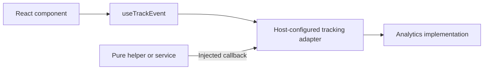

# @odh-dashboard/analytics

Shared analytics contracts, React providers, and Segment implementation for ODH Dashboard.

## Purpose

Provides shared tracking contracts and the concrete Segment implementation for host applications. Feature packages describe events; the host decides how those events are delivered.

## Design



The host mounts `AnalyticsTrackingProvider` with a `value` containing `trackEvent` and `trackPageEvent` callbacks. React components and custom hooks obtain those callbacks through `useTrackEvent()` and `useTrackPageEvent()` from `@odh-dashboard/analytics/react`. The provider neither initializes an SDK nor emits events. Invoking an operation without a provider throws; disabled hosts supply explicit stable no-ops. Pure helpers and services receive it as an argument, so they can fire events without calling React hooks.

Custom events use one operation: `trackEvent(name, properties)`. Keep event names, privacy-reviewed payload types, and event builders in the feature that owns them.

### Ownership

| Layer                    | Responsibility                                                                                                                                    |
| ------------------------ | ------------------------------------------------------------------------------------------------------------------------------------------------- |
| Feature                  | Define event names and properties, choose when to emit events, and pass tracking callbacks into pure helpers.                                     |
| Host / distribution      | Supply the callback, apply consent and enablement policy, initialize the SDK, bind environment metadata, and own page tracking and user identity. |
| Analytics implementation | Integrate with the Segment SDK, deliver custom/page/identity events, and provide anonymous user ID hashing.                                       |

Each distribution supplies a concrete adapter or an explicit intentional no-op. Mount the provider for every application entry point that renders tracking-hook consumers; do not rely on an unmounted context to disable tracking.

Page and identity operations belong to the host lifecycle. Keep them separate from feature custom events to preserve routing, identity, and event-count semantics.

### Import Boundaries

- `@odh-dashboard/analytics`: implementation functions for host integration.
- `@odh-dashboard/analytics/standalone`: the compatibility factory for standalone bootstrap wiring, without SDK initialization.
- `@odh-dashboard/analytics/types`: SDK-free shared contracts, including `TrackEvent`, `TrackPageEvent`, `TrackingOutcome`, and property types. This entry point imports neither React nor Segment.
- `@odh-dashboard/analytics/react`: the SDK-free provider and tracking hooks. This entry point imports neither the implementation nor Segment. Its context is shared as a singleton across hosts and federated remotes.

Use the contracts and React entry points in feature code, and reserve the standalone entry point for standalone bootstrap wiring. The `@odh-dashboard/no-direct-analytics` lint rule allows only the contracts and React entry points in guarded files; standalone bootstrap files use a file-specific override.

## Usage

### Feature Helpers

```ts
import { TrackingOutcome, type TrackEvent } from '@odh-dashboard/analytics/types';

export const fireModelDeleted = (trackEvent: TrackEvent, outcome: TrackingOutcome): void => {
  trackEvent('Model Deleted', { outcome, type: 'single' });
};
```

A React caller obtains `trackEvent` with `useTrackEvent()` and passes it to the helper from its event handler. Non-React callers receive the same callback through their arguments or constructor. Keep callback ownership explicit rather than storing a global tracking function.

### Host Integration

Use `createSegmentTracking` from the implementation entry point to create stable custom-event and page callbacks. Supply a getter for current cluster ID, development mode, app version, and optional delivery enablement. The shared adapter reads it on every call, so hosts configure delivery without implementing the callbacks. Pass the resulting object as the provider's `value`. Keep that object stable between renders, and replace it when callbacks change, following React context conventions.

```tsx
import { AnalyticsTrackingProvider } from '@odh-dashboard/analytics/react';
import { createSegmentTracking } from '@odh-dashboard/analytics';

// Create once; read current host settings when an event is sent.
const tracking = createSegmentTracking(() => ({
  clusterID: getClusterID(),
  devMode: DEV_MODE,
  version: APP_VERSION,
  enabled: isTrackingEnabled(),
}));

<AnalyticsTrackingProvider value={tracking}>
  <App />
</AnalyticsTrackingProvider>;
```

RHOAI uses the shared Segment adapter with its existing runtime metadata and SDK enablement behavior. Its legacy custom/page helpers reuse the same adapter. RHAII, MaaS Portal, and intentionally disabled standalone roots mount `NoopAnalyticsTrackingProvider` from `@odh-dashboard/analytics/react`. It supplies stable no-ops for both operations; tests needing spies use `AnalyticsTrackingProvider`. Federated feature roots inherit the host provider. Keep SDK initialization, consent, router effects, and identity in the host lifecycle.

Standalone roots call `createStandaloneAnalytics({ devMode, version })` from `@odh-dashboard/analytics/standalone` once outside React rendering and pass the result to `AnalyticsTrackingProvider`. The application supplies its build-time values. The factory logs events in development mode; otherwise, it forwards through an existing `window.analytics` and remains silent when none exists. It reads the current `window.clusterID` per operation, defaulting to `''`. It neither initializes the SDK nor changes consent or identity ownership. Hosts with different metadata or delivery policies use `createSegmentTracking(getOptions)` explicitly.

### SDK Initialization

`initSegment` initializes the shared browser client on `window.analytics`. It skips initialization when disabled or given an empty key. It does **not** stop an existing client, and repeated enabled calls load a client again.

The two `enabled` options control different operations:

- `initSegment({ enabled: false, ... })` skips initialization. It does not stop delivery through an existing client.
- Returning `enabled: false` from the `createSegmentTracking` options getter suppresses subsequent custom-event and page calls through that adapter. It does not stop identity calls, other delivery paths, or events already queued by the SDK.

Hosts coordinate initialization and configuration changes, apply current enablement to every delivery path, and decide how to handle queued events when tracking is disabled.

After the host has authorized initialization:

```ts
import { initSegment, computeAnonymousUserId } from '@odh-dashboard/analytics';

await initSegment({ segmentKey: 'write-key', enabled: true });

// Compute an anonymous user ID (SHA-1 hash).
const anonId = await computeAnonymousUserId('username');
```

## Verification

Feature tests inject callback spies through the real analytics provider or directly into pure helpers and assert event names, literal payloads, and counts. Host adapter tests verify metadata, enablement, and forwarding to the implementation. Exercise intentional no-op adapters to ensure application interactions remain functional when tracking is disabled.
