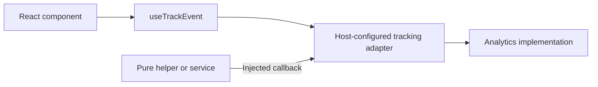

# @odh-dashboard/analytics

Shared analytics contracts, React providers, and Segment implementation for ODH Dashboard.

## Purpose

Provides shared tracking contracts and the concrete Segment implementation for host applications. Feature packages describe events; the host decides how those events are delivered.

## Design



The host mounts `AnalyticsTrackingProvider` with a `value` containing `trackEvent` and `trackPageEvent` callbacks. React components and custom hooks obtain those callbacks through `useTrackEvent()` and `useTrackPageEvent()` from `@odh-dashboard/analytics/react`. The provider neither initializes an SDK nor emits events. Invoking an operation without a provider throws; disabled hosts supply explicit stable no-ops. Pure helpers and services receive it as an argument, so they can fire events without calling React hooks.

Custom events use one operation: `trackEvent(name, properties)`. Keep event names, privacy-reviewed payload types, and event builders in the feature that owns them. Property values may include `null` and `readonly string[]` (e.g. document events); adapters must preserve both without mutation or dropping `null` vs `undefined`.

### Ownership

| Layer                    | Responsibility                                                                                                                                    |
| ------------------------ | ------------------------------------------------------------------------------------------------------------------------------------------------- |
| Feature                  | Define event names and properties, choose when to emit events, and pass tracking callbacks into pure helpers.                                     |
| Host / distribution      | Supply the callback, apply consent and enablement policy, initialize the SDK, bind environment metadata, and own page tracking and user identity. |
| Analytics implementation | Integrate with the Segment SDK, deliver custom/page/identity events, and provide anonymous user ID hashing.                                       |

Each distribution supplies a concrete adapter or an explicit intentional no-op. Mount the provider for every application entry point that renders tracking-hook consumers; do not rely on an unmounted context to disable tracking.

Page and identity operations belong to the host lifecycle. Keep them separate from feature custom events to preserve routing, identity, and event-count semantics.

### Import Boundaries

- `@odh-dashboard/analytics`: implementation functions for host integration.
- `@odh-dashboard/analytics/standalone`: the compatibility factory for standalone bootstrap wiring, without SDK initialization.
- `@odh-dashboard/analytics/types`: SDK-free shared contracts, including `TrackEvent`, `TrackPageEvent`, `TrackingOutcome`, and property types. This entry point imports neither React nor Segment.
- `@odh-dashboard/analytics/react`: the SDK-free provider and tracking hooks. This entry point imports neither the implementation nor Segment. Its context is shared as a singleton across hosts and federated remotes.

Use the contracts and React entry points in feature code, and reserve the standalone entry point for standalone bootstrap wiring. The `@odh-dashboard/no-direct-analytics` lint rule allows only the contracts and React entry points in guarded files; standalone bootstrap files use a file-specific override.

## Usage

### Feature Helpers

```ts
import { TrackingOutcome, type TrackEvent } from '@odh-dashboard/analytics/types';

export const fireModelDeleted = (trackEvent: TrackEvent, outcome: TrackingOutcome): void => {
  trackEvent('Model Deleted', { outcome, type: 'single' });
};
```

A React caller obtains `trackEvent` with `useTrackEvent()` and passes it to the helper from its event handler. Non-React callers receive the same callback through their arguments or constructor. Keep callback ownership explicit rather than storing a global tracking function.

### Host Integration

Use `createSegmentTracking` from the implementation entry point to create stable custom-event and page callbacks. Supply a getter for current cluster ID, development mode, app version, and optional delivery enablement. The shared adapter reads it on every call, so hosts configure delivery without implementing the callbacks. Pass the resulting object as the provider's `value`. Keep that object stable between renders, and replace it when callbacks change, following React context conventions.

```tsx
import { AnalyticsTrackingProvider } from '@odh-dashboard/analytics/react';
import { createSegmentTracking } from '@odh-dashboard/analytics';

// Create once; read current host settings when an event is sent.
const tracking = createSegmentTracking(() => ({
  clusterID: getClusterID(),
  devMode: DEV_MODE,
  version: APP_VERSION,
  enabled: isTrackingEnabled(),
}));

<AnalyticsTrackingProvider value={tracking}>
  <App />
</AnalyticsTrackingProvider>;
```

The adapter forwards events to `window.analytics`, the client assigned by `initSegment` during host setup. The host's `segmentKey` becomes the SDK's write key, which identifies the Segment source; `apiHost` and `protocol` configure the ingestion endpoint. Cluster ID and app version are event metadata. In development mode, the adapter logs events; otherwise, calls made before a client exists are dropped.

RHOAI uses the shared Segment adapter with its existing runtime metadata and SDK enablement behavior. Its legacy custom/page helpers reuse the same adapter. RHAII, MaaS Portal, and intentionally disabled standalone roots mount `NoopAnalyticsTrackingProvider` from `@odh-dashboard/analytics/react`. It supplies stable no-ops for both operations; tests needing spies use `AnalyticsTrackingProvider`. Federated feature roots inherit the host provider. Keep SDK initialization, consent, router effects, and identity in the host lifecycle.

Standalone roots that need compatibility with an externally initialized client call `createStandaloneAnalytics({ devMode, version })` from `@odh-dashboard/analytics/standalone` once outside React rendering and pass the result to `AnalyticsTrackingProvider`. The application supplies its build-time values. The factory logs events in development mode; otherwise, it forwards through an existing `window.analytics` and remains silent when none exists. It reads the current `window.clusterID` per operation, defaulting to `''`. It neither initializes the SDK nor changes consent or identity ownership. Intentionally disabled roots use the no-op provider. Hosts with different metadata or delivery policies use `createSegmentTracking(getOptions)` explicitly.

### Reusable host setup

Use `useSegmentSetup` from `@odh-dashboard/analytics` to initialize Segment and invoke host-owned identity and page callbacks. Hosts obtain their own key, readiness, enablement, and cluster/user information. Use `createSegmentTracking` to bind delivery metadata such as cluster ID, development mode, and version.

Changing the identify or page callback reference does not rerun setup. Setup uses the latest committed callbacks when initialization resolves. `usePageTracking` also uses the latest committed page callback, but invokes it only on mount and when the route key changes.

For `userKey`, use any stable value that changes when the user changes, such as a username or user ID. RHOAI uses the username.

```tsx
import { usePageTracking, useSegmentSetup } from '@odh-dashboard/analytics';

// Inside the host's setup component; callback references may change between renders.
useSegmentSetup({
  segmentKey,
  ready: configurationLoaded && identityLoaded,
  enabled: initializationEnabled, // Controls SDK initialization and setup identify/page calls.
  clusterID,
  userKey: userID,
  identify,
  trackPageEvent: tracking.trackPageEvent,
  // Each host supplies its own connection endpoints.
  cdnURL: segmentCdnURL,
  apiHost: segmentApiHost,
  protocol: 'https',
});
usePageTracking(pathname, tracking.trackPageEvent);
```

`enabled: false` skips SDK initialization and the setup identify and page callbacks. If the host commits `enabled: false` while initialization is pending, that pending setup also skips its callbacks. A setup started while disabled cannot emit after a later enable; the newly enabled setup owns those calls. This does not stop an existing client or gate the separate `usePageTracking` hook. To gate custom/page calls through the adapter, return `enabled: false` from its options getter; omitting that option allows delivery through an existing client.

Connection settings are host-supplied:

- `cdnURL`: required full CDN base URL, including the scheme, such as `https://cdn.example.com`.
- `apiHost`: required ingestion hostname and path, without a scheme, such as `events.example.com/v1`.
- `protocol`: optional ingestion protocol; defaults to `https`.

Each host obtains its user information and supplies an `identify` callback. Its reference does not need to remain stable. RHOAI keeps `useTrackUser` in the main frontend because it reads dashboard Redux state and checks OpenShift project-creation permissions, then uses its existing `fireIdentifyEvent` mapping. Distributions can use different identity sources and traits. The shared `computeAnonymousUserId` utility is available when a host needs to hash a username.

`usePageTracking` observes a host-supplied route key and has no router dependency; RHOAI continues to observe pathname changes through `useTrackHistory`.

Setup and route observation behave as follows:

- Setup skips all work when the key is empty or `ready` is false.
- Otherwise, setup assigns `window.clusterID` and invokes `initSegment`. When that function resolves, setup calls the latest committed identify callback followed by the latest committed page callback if setup is enabled.
- Effect cleanup invalidates that setup attempt's pending identify/page callbacks when setup inputs change or the component unmounts, including Strict Mode effect replay. It does not cancel SDK initialization or stop the client.
- `usePageTracking` invokes its latest callback on mount and when the route key changes, independently of setup readiness and enablement. Setup and route observation can each emit an initial page event.
- Changed setup inputs can initialize another client. These hooks do not add retries, event queues, deduplication, or SDK teardown.

### Per-event page-context policy

`TrackEvent` accepts optional delivery options as its third argument. A feature can supply a `pageContextPolicy` callback, typed entirely from `@odh-dashboard/analytics/types`, to sanitize the page context captured for that event. Existing two-argument calls retain their behavior.

The concrete adapter uses the SDK's page-context utility, including canonical URL handling, then applies the policy before forwarding a native `context.page` override. The policy must return all five page fields (`path`, `url`, `referrer`, `search`, and `title`) as strings. Incomplete results cause a synchronous error, and exceptions thrown by the policy propagate to the caller. Both prevent SDK delivery. Policies are per-event, are never serialized, and need no registration or shared registry.

Disabled delivery, development logging, and absent SDKs do not evaluate policies. Page and identity operations are unchanged. Hosts forwarding custom events must pass all `TrackEvent` arguments to their concrete adapter; explicit no-op hosts continue discarding events. Deploy updated concrete adapters before consumers start supplying policy options; older adapters do not apply this capability.

### SDK Initialization

`initSegment` assigns a Segment browser client to `window.analytics` without waiting for SDK readiness. Segment buffers events while loading. It skips initialization when disabled or given an empty key; repeated enabled calls with a nonempty key load another client. It uses the connection settings described above.

Awaiting `initSegment()` waits only for the initialization function to return after assigning the client, or skipping initialization. It does not wait for SDK readiness or successful event delivery.

The two `enabled` options control different operations:

- `initSegment({ enabled: false, ... })` skips initialization. It does not stop delivery through an existing client.
- Returning `enabled: false` from the `createSegmentTracking` options getter suppresses subsequent custom-event and page calls through that adapter. It does not stop identity calls, other delivery paths, or events already queued by the SDK.

Hosts coordinate initialization and configuration changes, apply current enablement to every delivery path, and decide how to handle queued events when tracking is disabled.

After the host has authorized initialization:

```ts
import { initSegment, computeAnonymousUserId } from '@odh-dashboard/analytics';

await initSegment({
  segmentKey: 'write-key',
  enabled: true,
  cdnURL: segmentCdnURL,
  apiHost: segmentApiHost,
});

// Compute an anonymous user ID (SHA-1 hash).
const anonId = await computeAnonymousUserId('username');
```

## Verification

Feature tests inject callback spies through the real analytics provider or directly into pure helpers and assert event names, literal payloads, and counts. Host adapter tests verify metadata, enablement, and forwarding to the implementation. Exercise intentional no-op adapters to ensure application interactions remain functional when tracking is disabled.
